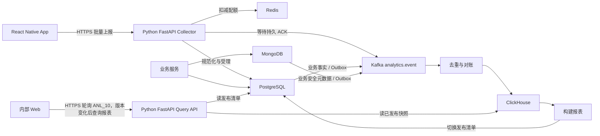

# ipaklink 埋点数据后台功能清单与数据库接口设计

版本 3.0 · 2026-11-16 · 研发与联调评审

独立部署与数据访问边界以[技术设计 v1.2](./ipaklink-埋点数据后台技术设计.md#0-独立系统的交付边界)为准。ipaklink App 嵌入采集 SDK，既有业务服务经 Kafka 或受控接口提供安全事实，埋点服务使用独立的数据空间与账号。

本次开发统一交付 [冻结功能清单 v4.1](./ipaklink-埋点数据后台功能清单.md#2-功能全清单) 的 53 项功能。HTTP 联调、分页及 Mock 使用 [本次 API 接口文档](./ipaklink-埋点数据后台API接口文档.md)。下文的既有范围标记和旧接口示例用于查阅原技术设计。

本文把功能、字段、数据库与接口放在同一条交付链上。经营指标由 ClickHouse 上的已发布快照提供，询盘以 PostgreSQL 为权威来源，聊天、翻译记录、语料及业务浏览明细由 MongoDB 承载，Redis 控制入口流量，Kafka 负责异步运输，运行与审计镜像使用 JSON Lines `.log`。现有 45 个功能编号、24 个事件编号及 `IPK_ANL` 接口编号继续使用。下文数据库模型中的新增表、字段、索引为实施设计，尚未执行迁移。

## 1. 阅读索引

|要做的工作|查阅位置|
|---|---|
|拆研发和测试任务|§3 功能工作项，§4 逐事件字段与采集接口|
|做数据库迁移、消费者或报表作业|§5 数据库设计，§6 数据访问接口和事务边界|
|联调 App、后台或 Kafka|§4 事件字段，§7 接口清单；原接口文档提供完整请求响应样例|
|确认业务指标和上线条件|§2 核心流程，§8 验收与待确认项|

## 2. 系统边界与核心流程

|业务场景|采集和事实链|看板口径|
|---|---|---|
|活跃与页面|会话建立、页面进入、结算；页面访问以 pageViewId 合并|登录 DAU/WAU/MAU 独立去重，匿名 UV 单列；企业业务 PV 由 POST /views 的持久事实计算|
|搜索到详情 F02|提交 → 首屏有结果 → 打开结果 → 相同企业或产品详情；关联 searchId 和目标|15 分钟内按搜索实例计数。纯用户搜索只进入搜索分析，失败和零结果分别统计|
|详情到询盘 F01|详情曝光 → 联系 → 提交 → PG 成功；使用 pageViewId、contactFlowId、clientRequestId|同一登录主体和业务目标在 24 小时内逐步匹配。按详情锚点看转化，按提交日期看业务总量|
|聊天|进入真实会话、MongoDB 首次持久化消息；关联 dialogRef|按真实人工消息计算对侧 24 小时首次回复，系统消息及询盘卡片排除|
|翻译|任务开始/终态用 taskId，记录同步用 recordRef|执行成功率和记录同步失败率分别计算；成功样本给出耗时 P95|
|留存|每日有效活跃与独立首活事实|D1/D7/D30 按首活自然日及首活维度。未过观察期或水位未到时返回未成熟|

看板默认最近 7 个完整业务日，业务日期暂用 Asia/Tashkent，接口时间统一 UTC。前端在总览、详情及下钻间复用 snapshotId。查询返回数据水位、生成时间、口径版本和成熟状态。零事件为 0，无有效分母或未成熟结果为 null。

## 3. 功能工作项

本节沿用原功能清单的 45 个工作项。各条目的编号、优先级、主责、数据落点和验收条件如下。与分析事件相关的功能进一步拆成 §4 的 24 个事件。

### 3.1 客户端采集

|编号|功能点|优先级|主责|表 / 集合 / 状态|接口 / 事件|验收条件|
|---|---|---|---|---|---|---|
|SDK-01|配置与灰度|P0|端 / 采集|analytics_event_schema、端侧配置缓存|ANL_01|关停策略生效后停止上报；已有未过期配置按 TTL 使用|
|SDK-02|匿名凭据及账号隔离|P0|端 / 采集|installId、identityEpoch、analytics_ingest_receipt|ANL_02、03|切换账号后旧队列不进入新账号；匿名补报按原 epoch|
|SDK-03|会话和前后台|P0|端|端侧 SQLite 队列、events_canonical|app_session_start、app_background [EVT_01](./ipaklink-埋点数据后台接口文档.md#431-evt_01-app_session_start)、[EVT_02](./ipaklink-埋点数据后台接口文档.md#432-evt_02-app_background)|冷启动、超时、切号新建会话；重复 AppState 回调不重复上报|
|SDK-04|页面进入与退出|P0|端 / 数据|fact_page_visit|screen_view、screen_exit [EVT_03](./ipaklink-埋点数据后台接口文档.md#433-evt_03-screen_view)、[EVT_04](./ipaklink-埋点数据后台接口文档.md#434-evt_04-screen_exit)|叶子路由正确；重复回调不加 PV；20s 前台加 10s 前台的结果为 30s|
|SDK-05|离线队列和批次回执|P0|端 / 采集|独立 SQLite 采集队列|ANL_03|断网重启后可补发；按事件回执逐条删除或保留；同一 eventId 重试稳定|
|SDK-06|采集字段白名单|P0|端 / 采集|analytics_event_schema|ANL_03|任意新增属性和非法枚举返回 rejected；正文、凭据和完整联系方式不入队|
|SDK-07|通知点击行为|P1|端|events_canonical|notification_open [EVT_17](./ipaklink-埋点数据后台接口文档.md#473-evt_17-notification_open)|从通知实际打开时计一次，按通知类别入仓校验|
|SDK-08|翻译使用深度|P1|端|events_canonical|message_translation_toggle、translate_copy [EVT_18](./ipaklink-埋点数据后台接口文档.md#474-evt_18-message_translation_toggle)、[EVT_22](./ipaklink-埋点数据后台接口文档.md#484-evt_22-translate_copy)|实际切换译文或成功复制才上报|

### 3.2 业务采集

|编号|功能点|优先级|主责|表 / 集合 / 状态|接口 / 事件|验收条件|
|---|---|---|---|---|---|---|
|BIZ-01|搜索全链路|P0|端 / 数据|fact_search|现有 GET /search、ANL_03；search_submit、search_result、search_result_open [EVT_05](./ipaklink-埋点数据后台接口文档.md#441-evt_05-search_submit)、[EVT_06](./ipaklink-埋点数据后台接口文档.md#442-evt_06-search_result)、[EVT_07](./ipaklink-埋点数据后台接口文档.md#443-evt_07-search_result_open)|首次结果与搜索提交可关联；翻页保持 searchId；用户搜索可统计但排除出企业漏斗|
|BIZ-02|实体曝光与业务浏览|P0|业务 / 端 / 数据|fact_page_visit、company_view_raw、Redis 业务计数|ANL_B02；entity_detail_view、business_view_recorded [EVT_08](./ipaklink-埋点数据后台接口文档.md#444-evt_08-entity_detail_view)、[EVT_09](./ipaklink-埋点数据后台接口文档.md#451-evt_09-business_view_recorded)|详情业务对象可见才发曝光；两个有效业务浏览计两个业务 PV，普通页面 PV 不叠加|
|BIZ-03|收藏与取消|P0|业务|user_actions、analytics_outbox|ANL_B05；favorite_changed [EVT_10](./ipaklink-埋点数据后台接口文档.md#452-evt_10-favorite_changed)|实际关系变更才投递，重复幂等调用不新增事实|
|BIZ-04|联系、提交及成功询盘|P0|业务 / 端 / 数据|inquiries、analytics_outbox、fact_inquiry_flow|ANL_B01、K02；contact_supplier_click、inquiry_submit、inquiry_submit_failed、inquiry_created [EVT_11](./ipaklink-埋点数据后台接口文档.md#461-evt_11-contact_supplier_click)、[EVT_12](./ipaklink-埋点数据后台接口文档.md#462-evt_12-inquiry_submit)、[EVT_13](./ipaklink-埋点数据后台接口文档.md#463-evt_13-inquiry_submit_failed)、[EVT_14](./ipaklink-埋点数据后台接口文档.md#464-evt_14-inquiry_created)|同一请求重试只产生一个成功事实；无归因键仍计业务总量|
|BIZ-05|会话打开与消息持久化|P0|业务 / 端 / 数据|messages、analytics_mongo_outbox、fact_dialog_reply|ANL_B03；chat_session_open、message_send_succeeded [EVT_15](./ipaklink-埋点数据后台接口文档.md#471-evt_15-chat_session_open)、[EVT_16](./ipaklink-埋点数据后台接口文档.md#472-evt_16-message_send_succeeded)|示例会话排除；发送重试不重计；询盘卡片与人工普通消息区分|
|BIZ-06|翻译执行与记录同步|P0|端 / 业务 / 数据|translate_records、fact_translate_task|ANL_B04；translate_started、translate_completed、translate_sync_completed [EVT_19](./ipaklink-埋点数据后台接口文档.md#481-evt_19-translate_started)、[EVT_20](./ipaklink-埋点数据后台接口文档.md#482-evt_20-translate_completed)、[EVT_21](./ipaklink-埋点数据后台接口文档.md#483-evt_21-translate_sync_completed)|本地成功与同步失败可以同时成立，统计分别入账；文本、对话、图片、文件可分组|
|BIZ-07|账号注册事实|P1|业务|users、analytics_outbox|account_registered [EVT_23](./ipaklink-埋点数据后台接口文档.md#491-evt_23-account_registered)|注册事务成功后按用户去重，手机或邮箱渠道字段可在仓库核验|

### 3.3 接入与可靠传输

|编号|功能点|优先级|主责|表 / Topic / 状态|接口|验收条件|
|---|---|---|---|---|---|---|
|ING-01|认证与策略校验|P0|采集|认证主体、事件注册表|ANL_01–03|匿名凭据只能上报绑定安装/epoch，登录主体从认证上下文取得|
|ING-02|Redis 入口限流|P0|采集 / 平台|Redis 限流命名空间|ANL_02、03、后台查询|限额超出时 429 和 Retry-After；Redis 故障时采集入口返回可重试 503|
|ING-03|批次校验与事件级回执|P0|采集|analytics_ingest_receipt|ANL_03|外层超过限额返回 413；同一合法批次可出现四种逐条回执|
|ING-04|Kafka 生产与持久确认|P0|采集 / 平台|analytics.event|ANL_K01|Kafka 确认后才返回 accepted；ACK 未知重试同一 eventId|
|ING-05|业务可靠投递|P0|业务 / 平台|PG 与 Mongo Outbox、inquiries.created|ANL_K01、K02|进程在事务后退出仍可补发；位点只在下游持久确认后推进|
|ING-06|消费重试和死信|P0|数据 / 平台|analytics.event.dlq.v1|ANL_K03|临时失败重试；永久失败经清洗入 DLQ；位点不跳过未持久化记录|
|ING-07|结构化文件日志|P0|平台 / 采集|JSON Lines .log、analytics_admin_audit|所有服务|访问、运行、错误、重放及审计均有 .log；可轮转续传；无原始请求体和正文|

### 3.4 数仓与质量

|编号|功能点|优先级|主责|数据模型|接口 / 作业|验收条件|
|---|---|---|---|---|---|---|
|DW-01|原始事实接收|P0|数据|events_raw|ANL_K01|可按原 Kafka 分区和位点追踪；非法正文在落仓前拦截|
|DW-02|逻辑去重及冲突隔离|P0|数据 / 采集|events_canonical、analytics_ingest_receipt|内部去重构建|重试、回放和消费者重启后报表只计一次；冲突版本可追踪|
|DW-03|安全维度与主体|P0|数据 / 业务|dim_entity_safe、fact_actor_active_day、首活索引|内部维度同步|历史事件保留事件时快照，登录跨端去重，匿名独立|
|DW-04|事实和聚合|P0|数据|fact_page_visit、fact_search、fact_inquiry_flow、fact_dialog_reply、fact_translate_task、agg_metric_day、agg_retention_day|内部聚合|跨日 UV 重算，分位数可合并，观察未成熟返回 provisional|
|DW-05|快照版本与回滚|P0|数据 / 平台|analytics_report_build、analytics_outbox|ANL_10、K04|校验成功才切换整份清单；失败保留前版；快照过期可重查|
|DW-06|业务对账与告警|P0|数据 / 平台|agg_quality_minute、inquiries、messages、company_view_raw|ANL_17|按同一业务日期及水位展示来源数、仓库数和差值|
|DW-07|回放与日期重算|P0|数据 / 平台|analytics_repair_job、DLQ|ANL_21、22|dryRun 不发布；重放保留 ID；同幂等键重试只创建一单|
|DW-08|删除与留存|P0|平台 / 数据|analytics_subject_erasure、TTL、抑制清单|内部清理作业|主体清理覆盖明细和派生快照；回放或备份恢复后不复活数据|

### 3.5 看板页面与交互

|编号|页面 / 功能|优先级|主责|主要组件|接口|验收条件|
|---|---|---|---|---|---|---|
|BI-01|经营总览|P0|Web / 数据|指标卡、日趋势、同期对比|ANL_11|DAU/WAU/MAU、匿名 UV、业务 PV、询盘量及翻译成功率均可查询|
|BI-02|页面分析|P0|Web / 数据|PV/UV 榜、闭合率、退出率、五桶停留图|ANL_12|筛选到单页时五个桶齐全；时长分母可查看|
|BI-03|搜索与收藏分析|P0|Web / 数据|搜索请求、零结果和打开率、收藏变化|ANL_13|成功但零结果与失败分开，收藏和取消分别展示|
|BI-04|询盘与搜索漏斗|P0|Web / 数据|F01/F02 条形图、耗时、未归因原因|ANL_14|F01 以 24 小时、F02 以 15 分钟判定；阶段与归因分母可复核|
|BI-05|聊天与翻译|P0|Web / 数据|发送量、24h 回复、语言对、翻译耗时和错误|ANL_13|人工与系统消息分类正确；执行成功率与同步失败率分开|
|BI-06|活跃留存|P0|Web / 数据|Cohort 热力矩阵与成熟提示|ANL_15|D1/D7/D30 可筛选；未成熟显示预计日期；历史未知 cohort 单列|
|BI-07|质量看板|P0|Web / 数据|受理、拒绝、延迟、Lag、对账、作业状态|ANL_17、21、22|可定位来源、版本和异常日期；清楚显示过期或部分数据|
|BI-08|元数据和版本刷新|P0|Web / 平台|权限菜单、快照、全局筛选、通知和轮询|ANL_10、K04、WS_01|收到通知按权限刷新；断线可轮询；旧请求响应不覆盖新筛选|
|BI-09|数据展示状态|P0|Web / 数据|加载、空数据、权限不足、缺分母、低基数|ANL_11–18|无分母不显示 0%；低基数输出 suppressed；同页卡片共用 snapshotId|
|BI-10|会话时间线|P1|Web / 平台|受控元数据、页面停留、步骤终态|ANL_16|工单与权限有效后才可读取；分页稳定，内容无原文和译文|

### 3.6 权限和语料治理

|编号|功能点|优先级|主责|表 / 集合|接口 / 事件|验收条件|
|---|---|---|---|---|---|---|
|GOV-01|角色和数据范围|P0|平台 / 业务|analytics_access_grant|后台全部查询|运营、分析、值班、受控排查、语料角色按数据范围分别授权|
|GOV-02|受控操作审计|P0|平台|analytics_admin_audit、审计 .log|ANL_16、19、21|记录操作者、工单、范围、结果；审计写入失败时拒绝敏感操作|
|GOV-03|聊天、翻译与分析隔离|P0|业务 / 平台|messages、translate_records、ClickHouse|ANL_K01、K03|行为库、Topic、日志及死信中找不到正文和凭据|
|GOV-04|语料汇总与作业状态|P1|业务 / Web|corpus_datasets、corpus_items、语料作业状态|ANL_18、19；corpus_asset_status_changed [EVT_24](./ipaklink-埋点数据后台接口文档.md#492-evt_24-corpus_asset_status_changed)|按数据集、语言对、状态可查，越权返回 403，汇总可追溯到受权作业|
|GOV-05|语料用途与撤回传播|P1|业务 / 平台|corpus_datasets、corpus_items|内部治理作业|启用来源须校验用途与授权；撤回后影响关联条目和统计|

## 4. 逐事件字段与采集接口

本节列全 24 个事件的专用字段。App 事件经 `POST /ipaklink/v1/analytics/events/report`（IPK_ANL_03）提交，事件字段位于 `events[]`，业务专用字段位于 `events[].properties`。服务端从权威业务记录派生安全消息，专用字段位于 Kafka `analytics.event` 的 `properties`。每个 EVT 编号链接到完整请求体或 Kafka 示例。字段之间的名称、含义和条件以对应事件契约为准。

### 4.1 通用传输字段

|位置|字段|类型与必填规则|
|---|---|---|
|App 批次|batchId、installId、identityEpoch|UUID，必填，固定安装及身份阶段|
|App 批次|identityType、platform、appVersion、policyVersion、events|必填，分别为身份枚举、平台枚举、字符串、正整数、1–100 条事件|
|App 批次|appLanguage、regionId|string / int，选填，使用业务字典|
|App events[]|eventId、eventName、schemaVersion、occurredAt、sessionId、sequence、properties|必填，分别为 UUID、事件枚举、版本整数、UTC RFC3339、UUID、会话内整数序号、对象|
|App events[]|screenName、pageViewId|string / UUID，页面进入、退出、实体曝光、联系点击必填|
|Kafka 业务 event|eventId、eventName、schemaVersion、occurredAt、receivedAt、businessDate、source、producer|必填，稳定 ID、注册事件名、版本、两个 UTC 时间、业务日、来源、生产者|
|Kafka 业务 event|identityType、actorKey、aggregateRef、payloadHash、properties|必填，身份枚举、主体假名或系统事实 null、分区安全引用、SHA-256 摘要、专用属性|
|Kafka 可补上下文|anonKey、sessionId、pageViewId、screenName、sequence、platform、appVersion、appLanguage、regionId、policyVersion、requestId、ingestBatchId|按可信上下文选择性补充；客户端凭据不转发|

身份从认证上下文取得。登录历史与匿名历史独立统计，退出或切换账号时旧队列仍按原身份分别处理。密码、验证码、认证 token、完整联系信息、原始搜索词、聊天和译文正文、语料正文及附件内容不进入分析通道。

### 4.2 各业务环节

#### 4.2.1 会话与页面

|事件编号 / eventName|所属功能|生产端 / 优先级|专用字段与条件|业务入口 / 分析接口|看板或校验入口|验收条件|
|---|---|---|---|---|---|---|
|[EVT_01 / §4.3.1](./ipaklink-埋点数据后台接口文档.md#431-evt_01-app_session_start) `app_session_start`|SDK-03|App / P0|`launchSource`（string，是）|端侧生命周期 `POST /ipaklink/v1/analytics/events/report`（IPK_ANL_03），Collector 写 K01|IPK_ANL_11、IPK_ANL_16|冷启动或切号新建 sessionId；同一会话只记一次启动，launchSource 与入口一致|
|[EVT_02 / §4.3.2](./ipaklink-埋点数据后台接口文档.md#432-evt_02-app_background) `app_background`|SDK-03|App / P0|`properties` 固定为空对象|端侧生命周期 `POST /ipaklink/v1/analytics/events/report`（IPK_ANL_03），Collector 写 K01|IPK_ANL_16|active→inactive→background 只产生一条；再次回前台后切后台可产生新事件|
|[EVT_03 / §4.3.3](./ipaklink-埋点数据后台接口文档.md#433-evt_03-screen_view) `screen_view`|SDK-04|App / P0|`entrySource`（string，是）|端侧导航 `POST /ipaklink/v1/analytics/events/report`（IPK_ANL_03），Collector 写 K01|IPK_ANL_12、IPK_ANL_16|首屏和真实切页各一个 pageViewId；重复回调与短后台返回不增加 PV|
|[EVT_04 / §4.3.4](./ipaklink-埋点数据后台接口文档.md#434-evt_04-screen_exit) `screen_exit`|SDK-04|App / P0|`visibleMs`（int，是）、`exitReason`（string，是）|端侧导航 `POST /ipaklink/v1/analytics/events/report`（IPK_ANL_03），Collector 写 K01|IPK_ANL_12、IPK_ANL_16|前台 20 秒、后台 30 秒、再前台 10 秒的 visibleMs 约为 30000；异常退出无结算|

#### 4.2.2 搜索与详情

|事件编号 / eventName|所属功能|生产端 / 优先级|专用字段与条件|业务入口 / 分析接口|看板或校验入口|验收条件|
|---|---|---|---|---|---|---|
|[EVT_05 / §4.4.1](./ipaklink-埋点数据后台接口文档.md#441-evt_05-search_submit) `search_submit`|BIZ-01|App / P0|`searchId`（UUID，是）、`scope`（string，是）、`queryLengthBucket`（string，是）、`filterCount`（int，是）|GET /search `POST /ipaklink/v1/analytics/events/report`（IPK_ANL_03），Collector 写 K01|IPK_ANL_13、IPK_ANL_14|新请求生成 searchId；翻页不新增提交；搜索原词和筛选原文不入仓|
|[EVT_06 / §4.4.2](./ipaklink-埋点数据后台接口文档.md#442-evt_06-search_result) `search_result`|BIZ-01|App / P0|`searchId`（UUID，是）、`scope`（string，是）、`outcome`（string，是）、`resultCount`（int，成功时必填）、`latencyMs`（int，是）、`errorCode`（string，失败时必填）|GET /search `POST /ipaklink/v1/analytics/events/report`（IPK_ANL_03），Collector 写 K01|IPK_ANL_13、IPK_ANL_14|成功零结果填写 0；失败带 errorCode 且无 resultCount；分页不覆盖首屏|
|[EVT_07 / §4.4.3](./ipaklink-埋点数据后台接口文档.md#443-evt_07-search_result_open) `search_result_open`|BIZ-01|App / P0|`searchId`（UUID，是）、`targetType`（string，是）、`targetId`（string，是）、`position`（int，是）|GET /search 返回结果；后续进入对应详情 `POST /ipaklink/v1/analytics/events/report`（IPK_ANL_03），Collector 写 K01|IPK_ANL_13、IPK_ANL_14|序号从 1 开始并计入分页偏移；用户结果的目标 ID 入仓前假名化|
|[EVT_08 / §4.4.4](./ipaklink-埋点数据后台接口文档.md#444-evt_08-entity_detail_view) `entity_detail_view`|BIZ-02|App / P0|`targetType`（string，是）、`targetId`（string，是）、`companyId`（string，是）、`productId`（string，产品时必填）、`searchId`（UUID，否）、`entrySource`（string，是）|`GET /companies/{companyId}`、`GET /products/{productId}`；各自响应的实体 ID 映射到事件字段。 `POST /ipaklink/v1/analytics/events/report`（IPK_ANL_03），Collector 写 K01|IPK_ANL_14|对象加载可见才触发；企业/产品目标与 ID 一致；搜索来源可通过 searchId 关联|

#### 4.2.3 浏览与收藏

|事件编号 / eventName|所属功能|生产端 / 优先级|专用字段与条件|业务入口 / 分析接口|看板或校验入口|验收条件|
|---|---|---|---|---|---|---|
|[EVT_09 / §4.5.1](./ipaklink-埋点数据后台接口文档.md#451-evt_09-business_view_recorded) `business_view_recorded`|BIZ-02|服务端 / P0|`viewRef`（string，是）、`targetType`（string，是）、`targetId`（string，是）|POST /views；IPK_ANL_B02 `analytics.event`（IPK_ANL_K01），仅受信任的内部生产者|IPK_ANL_11、IPK_ANL_17|MongoDB 持久化后出事件；同一 viewRef 去重，两次真实浏览保留两条|
|[EVT_10 / §4.5.2](./ipaklink-埋点数据后台接口文档.md#452-evt_10-favorite_changed) `favorite_changed`|BIZ-03|服务端 / P0|`targetType`（string，是）、`targetId`（string，是）、`action`（string，是）|POST /favorites；POST /favorites/cancel；IPK_ANL_B05 `analytics.event`（IPK_ANL_K01），仅受信任的内部生产者|IPK_ANL_13|添加和取消分别得到 add、remove；重复幂等请求无新增事实|

#### 4.2.4 询盘

|事件编号 / eventName|所属功能|生产端 / 优先级|专用字段与条件|业务入口 / 分析接口|看板或校验入口|验收条件|
|---|---|---|---|---|---|---|
|[EVT_11 / §4.6.1](./ipaklink-埋点数据后台接口文档.md#461-evt_11-contact_supplier_click) `contact_supplier_click`|BIZ-04|App / P0|`contactFlowId`（UUID，是）、`companyId`（string，是）、`productId`（string，否）|页面跳转 InquiryEdit，无独立写接口 `POST /ipaklink/v1/analytics/events/report`（IPK_ANL_03），Collector 写 K01|IPK_ANL_14|联系点击生成 contactFlowId 并传入表单，企业及产品标识一致|
|[EVT_12 / §4.6.2](./ipaklink-埋点数据后台接口文档.md#462-evt_12-inquiry_submit) `inquiry_submit`|BIZ-04|App / P0|`contactFlowId`（UUID，否）、`clientRequestId`（string，是）、`companyId`（string，是）、`productId`（string，否）|POST /inquiries；IPK_ANL_B01 `POST /ipaklink/v1/analytics/events/report`（IPK_ANL_03），Collector 写 K01|IPK_ANL_14|实际发出业务请求才上报；网络重试沿用 clientRequestId，计一次逻辑提交|
|[EVT_13 / §4.6.3](./ipaklink-埋点数据后台接口文档.md#463-evt_13-inquiry_submit_failed) `inquiry_submit_failed`|BIZ-04|App / P0|`clientRequestId`（string，是）、`attemptNo`（int，是）、`errorCode`（string，是）|POST /inquiries；IPK_ANL_B01 `POST /ipaklink/v1/analytics/events/report`（IPK_ANL_03），Collector 写 K01|IPK_ANL_16（授权会话时间线）|网络尝试号递增；失败使用固定错误码；表单未通过校验时无本事件|
|[EVT_14 / §4.6.4](./ipaklink-埋点数据后台接口文档.md#464-evt_14-inquiry_created) `inquiry_created`|BIZ-04|服务端 / P0|`inquiryRef`（string，是）、`companyId`（string，是）、`productId`（string，否）、`contactFlowId`（UUID，否）、`clientRequestId`（string，否）|POST /inquiries；inquiries.created（K02）；IPK_ANL_B01 `analytics.event`（IPK_ANL_K01），仅受信任的内部生产者|IPK_ANL_11、IPK_ANL_14、IPK_ANL_17|PG 已提交才投递；同一 inquiryId 只计一次；归因缺失仍计入成功总量|

#### 4.2.5 消息与通知

|事件编号 / eventName|所属功能|生产端 / 优先级|专用字段与条件|业务入口 / 分析接口|看板或校验入口|验收条件|
|---|---|---|---|---|---|---|
|[EVT_15 / §4.7.1](./ipaklink-埋点数据后台接口文档.md#471-evt_15-chat_session_open) `chat_session_open`|BIZ-05|App / P0|`dialogRef`（string，是）、`entrySource`（string，是）|GET /chat/dialogs/{id}/messages 是相关读取接口；进入页触发分析 `POST /ipaklink/v1/analytics/events/report`（IPK_ANL_03），Collector 写 K01|IPK_ANL_13|真实会话可见才触发；再次进入可记新事件；会话引用与发送事实一致|
|[EVT_16 / §4.7.2](./ipaklink-埋点数据后台接口文档.md#472-evt_16-message_send_succeeded) `message_send_succeeded`|BIZ-05|服务端 / P0|`dialogRef`（string，是）、`messageRef`（string，是）、`messageType`（string，是）、`senderKind`（string，是）|POST /chat/dialogs/{id}/messages；IPK_ANL_B03 `analytics.event`（IPK_ANL_K01），仅受信任的内部生产者|IPK_ANL_13、IPK_ANL_17|消息首次持久化计一次；补发无重复；人工、系统、询盘卡片分类正确|
|[EVT_17 / §4.7.3](./ipaklink-埋点数据后台接口文档.md#473-evt_17-notification_open) `notification_open`|SDK-07|App / P1|`category`（string，是）|GET /notifications 为列表读取；有已读动作时沿用 POST /notifications/read `POST /ipaklink/v1/analytics/events/report`（IPK_ANL_03），Collector 写 K01|仓库验收，暂无专用看板接口|实际点击通知才入仓，收到推送或已读回调不重复；按 category 抽验|
|[EVT_18 / §4.7.4](./ipaklink-埋点数据后台接口文档.md#474-evt_18-message_translation_toggle) `message_translation_toggle`|SDK-08|App / P1|`displayMode`（string，是）|端侧显示；如需同步译文仍走既有 POST /chat/messages/{id}/translations `POST /ipaklink/v1/analytics/events/report`（IPK_ANL_03），Collector 写 K01|仓库验收，暂无专用看板接口|切换后的 displayMode 正确；重复渲染和同状态点击不入仓|

#### 4.2.6 翻译

|事件编号 / eventName|所属功能|生产端 / 优先级|专用字段与条件|业务入口 / 分析接口|看板或校验入口|验收条件|
|---|---|---|---|---|---|---|
|[EVT_19 / §4.8.1](./ipaklink-埋点数据后台接口文档.md#481-evt_19-translate_started) `translate_started`|BIZ-06|App / P0|`taskId`（UUID，是）、`mode`（string，是）、`sourceLang`（string，是）、`targetLang`（string，是）|端侧翻译执行；记录同步独立 `POST /ipaklink/v1/analytics/events/report`（IPK_ANL_03），Collector 写 K01|IPK_ANL_13|任务实际开始才上报；主动重试生成新 taskId；同事件补传保留 eventId|
|[EVT_20 / §4.8.2](./ipaklink-埋点数据后台接口文档.md#482-evt_20-translate_completed) `translate_completed`|BIZ-06|App / P0|`taskId`（UUID，是）、`mode`（string，是）、`sourceLang`（string，是）、`targetLang`（string，是）、`outcome`（string，是）、`latencyMs`（int，是）、`errorCode`（string，失败时必填）|端侧翻译执行；记录同步独立 `POST /ipaklink/v1/analytics/events/report`（IPK_ANL_03），Collector 写 K01|IPK_ANL_13|taskId 与启动一致；首个有效终态计一次；失败带错误码，取消单列|
|[EVT_21 / §4.8.3](./ipaklink-埋点数据后台接口文档.md#483-evt_21-translate_sync_completed) `translate_sync_completed`|BIZ-06|服务端 / P0|`recordRef`（string，是）、`mode`（string，是）、`outcome`（string，是）|POST /translate/records、/translate/dialog-sessions、/translate/image-records、/translate/file-jobs；IPK_ANL_B04 `analytics.event`（IPK_ANL_K01），仅受信任的内部生产者|IPK_ANL_13|四种业务记录同步按模式区分；记录 ID 和状态版本去重；与执行成败分开|
|[EVT_22 / §4.8.4](./ipaklink-埋点数据后台接口文档.md#484-evt_22-translate_copy) `translate_copy`|SDK-08|App / P1|`mode`（string，是）|端侧剪贴板操作 `POST /ipaklink/v1/analytics/events/report`（IPK_ANL_03），Collector 写 K01|仓库验收，暂无专用看板接口|剪贴板写入成功才入仓，复制失败无事件；仅采集 mode|

#### 4.2.7 账号与语料

|事件编号 / eventName|所属功能|生产端 / 优先级|专用字段与条件|业务入口 / 分析接口|看板或校验入口|验收条件|
|---|---|---|---|---|---|---|
|[EVT_23 / §4.9.1](./ipaklink-埋点数据后台接口文档.md#491-evt_23-account_registered) `account_registered`|BIZ-07|服务端 / P1|`channel`（string，是）|POST /auth/register `analytics.event`（IPK_ANL_K01），仅受信任的内部生产者|仓库验收，暂无专用看板接口|用户首次注册事务提交才入仓；按权威用户键去重，原账号标识不入分析消息|
|[EVT_24 / §4.9.2](./ipaklink-埋点数据后台接口文档.md#492-evt_24-corpus_asset_status_changed) `corpus_asset_status_changed`|GOV-04|服务端 / P1|`datasetCode`（string，是）、`languagePair`（string，是）、`status`（string，是）、`reasonCode`（string，否）|内部治理作业；IPK_ANL_18、19 为查询接口 `analytics.event`（IPK_ANL_K01），仅受信任的内部生产者|IPK_ANL_18（语料汇总）；IPK_ANL_19 查询作业状态|状态真实变更才入仓；按数据集、语言对及状态核验汇总；审查原文不进入事件|

## 5. 数据库设计

### 5.1 PostgreSQL 事务和控制表

PG 类型约定 `uuid` 用于系统/事件 ID，业务时间统一 `timestamptz`，状态用受约束文本，JSONB 保存受控配置或安全消息。控制表记录的日期范围均为左闭右开。下表 PK 为主键，UQ 为唯一约束。

|表|字段及类型|键、索引与业务约束|
|---|---|---|
|analytics_event_schema|event_name:text、schema_version:int、source:text、property_schema:jsonb、status:text、created_at:timestamptz|PK(event_name,schema_version)；同一版本内兼容演进，停用状态仍支持已接受事件的历史重放|
|analytics_collection_policy（新增设计）|policy_version:int、rules:jsonb、status:text、effective_at:timestamptz、created_at:timestamptz|PK(policy_version)；保存平台、版本范围、灰度比例、匿名开关及批次限制。首版可通过部署管理，后台编辑接口待定义|
|analytics_ingest_receipt|event_id:uuid、producer_scope:text、subject_epoch:uuid、payload_hash:text、canonical_time:timestamptz、first_received_at:timestamptz、state:text、lease_token:uuid?、lease_until:timestamptz?、published_at:timestamptz?、expires_at:timestamptz|PK(event_id)，索引(expires_at)；pending/published；同 ID 不同摘要拒绝，只有当前租约可以确认发布|
|analytics_outbox|event_id:uuid、aggregate_id:text、topic:text、payload_safe:jsonb、status:text、attempts:int、available_at:timestamptz、lease_until:timestamptz?、created_at:timestamptz、published_at:timestamptz?|PK(event_id)；待发送部分索引(available_at,event_id)；业务事务或发布事务内插入|
|analytics_metric_def|metric_code:text、metric_version:int、dimension_set:jsonb、query_template_key:text、definition:jsonb、status:text|PK(metric_code,metric_version)；固定查询模板与允许维度|
|analytics_report_build|dataset:text、date_key:date、generation:bigint、source_offsets:jsonb、checksum:text、status:text、built_at:timestamptz|PK(dataset,date_key,generation)；保存构建输入水位和验证记录|
|analytics_report_snapshot（发布清单落表）|snapshot_id:text、metric_version:int、manifest:jsonb、generated_at:timestamptz、source_watermark:timestamptz、status:text|PK(snapshot_id)，已发布状态最多一条的部分唯一索引；历史允许查询到期前快照|
|analytics_repair_job|job_id:text、job_type:text、operator_id:text、idempotency_key:text、request_hash:text、scope:jsonb、ticket_id:text、dry_run:boolean、status:text、result:jsonb?、created_at:timestamptz、finished_at:timestamptz?|PK(job_id)，此表固定由同一创建端点写入，UQ(operator_id,idempotency_key)；同键请求比较 request_hash，负载有变化则返回 409；按状态和创建时间检索|
|analytics_access_grant|grant_id:uuid、principal_id:text、role_code:text、scope:jsonb、ticket_id:text?、expires_at:timestamptz?、revoked_at:timestamptz?|PK(grant_id)，索引(principal_id,role_code)；读取同时验证状态、有效期和数据范围|
|analytics_admin_audit|audit_id:uuid、operator_id:text、action:text、ticket_id:text?、scope_safe:jsonb、result_code:text、request_id:text、occurred_at:timestamptz|PK(audit_id)，索引(operator_id,occurred_at)、(request_id)；追加写入，镜像到 .log|
|analytics_subject_erasure|job_id:uuid、actor_key:text、status:text、requested_at:timestamptz、finished_at:timestamptz?|PK(job_id)，索引(actor_key,status)；回放和备份恢复依此执行抑制与清理|

权威业务表沿用 `users`、`companies`、`products`、`user_actions` 与 `inquiries`。询盘分析仅提取稳定标识、提交时间及关联键。App 上报的成功提示不写这些权威表。

### 5.2 ClickHouse 事件、事实与报表

类型约定 `DateTime64(3,'UTC')` 存时间，`Date` 存业务日，`UUID` 存事件及客户端生成的关联 ID，`String` 存安全业务 ID，`UInt64` 存计数和 Kafka offset。表内无值字段使用 Nullable；分析字段采用 snake_case。

|表|粒度和排序建议|核心列与用途|
|---|---|---|
|events_raw|每次 Kafka 投递；按接收月分区，排序(received_at,event_id)|event_id、event_name、source、occurred_at、received_at、actor_key、payload_hash、topic、partition、offset、properties_json；用于水位重放与定位|
|events_canonical|逻辑事件，按业务月分区，排序(business_date,event_id)|保留安全信封、匿名/登录标志、平台/版本/地区、session_id/page_view_id、源坐标；事件重试同 ID 固定分片|
|fact_page_visit|generation + page_view_id|actor_key、session_id、screen_name、business_date、entry_at、exit_at?、visible_ms?、closure_status、is_session_exit|
|fact_actor_active_day|generation + 业务日、actor_key、平台、版本、地区|identity_type 与首个合格活动时间，区间 UV 以 actor_key 去重|
|dim_actor_first_active（新增设计）|actor_key|first_business_date、first_event_id、平台/版本/地区、历史截断状态；首活边界独立维护并随清理重算|
|fact_search|generation + actor_key、search_id|submitted_at、first_result_at?、outcome?、result_count?、first_open_at?、detail_at?、scope、latency_ms?|
|fact_inquiry_flow|generation + actor_key、contact_flow_id|详情、联系、提交、成功时间，company_id、product_id?、page_view_id、client_request_id?、inquiry_ref?、归因状态|
|fact_inquiry_created（新增设计）|generation + inquiry_ref|submitted_at、company_id、product_id?、contact_flow_id?、attribution_reason?；完整保存成功总量及未归因事实|
|fact_dialog_reply|generation + dialog_ref、anchor_message_ref|sender_actor_key、anchor_at、reply_at?、latency_ms?、mature；同对话只认符合条件的对侧人工回复|
|fact_translate_task|generation + actor_key、task_id|mode、source_lang、target_lang、started_at、terminal_at?、outcome?、latency_ms?、error_code?|
|dim_entity_safe|实体类型、实体 ID、版本或生效时刻|地区、行业、分类等允许字段；取事件生效时维度|
|agg_metric_day|generation + 业务日、metric_code、dim_set、dim_values|可加计数、分子、分母、按区间去重或可合并去重状态、可合并分位状态|
|agg_retention_day|generation + cohort_date、offset_day、cohort_dim|cohort_size、retained_count?、mature、expected_mature_date|
|agg_quality_minute|generation + 分钟、服务、来源、版本|accepted、rejected、rate_limited、duplicate、late、dlq、lag_records 等|
|fact_reconciliation_day（新增设计）|generation + 业务日、fact_code、来源|source_count、warehouse_count、delta、unattributed_count、source_watermark；避免将每日业务差值误作分钟计数累加|

构建固定每个 Kafka 分区的输入位点，再从原始层按 eventId 显式去重并校验冲突。`ReplacingMergeTree` 可用于规范事件表的后台合并，发布任务需按固定水位计算，不能依赖后台合并时机。先写各数据集的新 generation，再原子更新 PG manifest。报表缓存包含查询参数、权限范围、口径和 snapshotId。日 UV、日 P95、日比率均不能直接相加；按区间去重、合并分位状态或重新计算分子分母。

### 5.3 MongoDB 业务内容与可靠事件

|集合|字段及分析边界|索引与写入约束|
|---|---|---|
|messages（既有）|messageId、dialogId、senderId、messageType、createdAt、撤回状态、聊天正文和译文；只向分析投影安全引用、类型、发送人类别及事实时间|沿用业务消息唯一键；查询按 dialogId、时间及稳定序号；首次持久化生成分析事实|
|translate_records 及各模式记录（既有）|recordId/clientRecordId、mode、sourceLang、targetLang、原文、译文、状态与 tombstone；分析层只接收 recordRef、mode、outcome|依各同步接口现有幂等键更新；同步事实按记录和状态版本去重|
|company_view_raw（既有）|viewRef、目标类型、目标 ID、业务时间；按访问次数对账|稳定操作键防重试重复；真实再次访问使用新键|
|corpus_datasets|datasetCode、purposeCode、revision、allowedLanguages、retentionDays、status|datasetCode + revision 唯一；访问按数据集用途及角色范围|
|corpus_items|itemId、datasetCode、sourceRef、revision、sourceLang、targetLang、text/fileRef、reviewStatus、policyRef、createdAt、expiresAt、tombstoneAt|datasetCode + sourceRef + revision 唯一；治理按 datasetCode、reviewStatus、createdAt 检索|
|corpus_jobs（新增设计）|jobRef、datasetCode、type、status、scannedCount、acceptedCount、rejectedCount、createdAt、finishedAt、errorCode|jobRef 唯一，按 datasetCode 和时间检索。现有接口能读取状态，发起写入仍走内部治理作业|
|analytics_mongo_outbox|eventId、aggregateRef、topic、payloadSafe、status、attempts、availableAt、leaseUntil、createdAt|eventId 唯一，按状态及 availableAt 领取；业务文档和出站记录同事务写入，或用可恢复的变更流加补扫|

### 5.4 Redis、Kafka、日志与保留

|介质|键、名称或格式|读写约束|
|---|---|---|
|Redis|采集请求按环境、入口和 IP 假名/安装 ID 限流，事件配额按主体或匿名安装；查询按操作者与成本限流|令牌桶，单键原子扣减，429 携 Retry-After；采集依赖故障返回 503；不存权威事实|
|Kafka|analytics.event、inquiries.created、analytics.event.dlq.v1、analytics.dashboard.updated.v1|分析输入主流建议 7 天，DLQ 14 天，更新 Topic 24 小时，既有询盘 Topic 仍由业务管理；ACK 与错误处理见 §6|
|.log|JSON Lines，包含 ts、level、service、env、component、requestId、traceId、action、resultCode、durationMs、count；消费者可附分区和位点|按日或 256 MiB 轮转，普通日志建议 30 天，审计镜像 180 天；审计权威记录在 PG，日志不复制请求正文|
|保留与清理|ClickHouse 原始/规范明细建议 90 天，聚合 13 个月，App 队列 7 天，受理映射建议 14 天|初始设计值，投产前确认。删除清单优先于回放，受影响日期重算，恢复备份后重新执行抑制与清理；内容和语料按独立用途期限|

## 6. 数据访问接口设计

本节定义服务内部的数据读写接口和事务。Web 与 App 的外部入口见 §7。

|内部接口|输入 / 输出|数据库动作与幂等边界|
|---|---|---|
|DB-01 校验事件版本|event_name、schema_version、source → 有效字段规则与策略版本|读取 PG 事件白名单和生效策略，按版本缓存；依据来源区分 App 与服务端|
|DB-02 领取受理记录|event_id、scope、epoch、hash、canonical_time → new / duplicate / conflict / retry + lease_token|PG 插入或锁定已有映射，同内容已确认返回 duplicate，未过期的其他租约返回 retry|
|DB-03 确认受理发布|event_id、lease_token、持久 ACK → published 或 retry|PG 带租约条件更新。Kafka 成功但 PG 确认失败时允许同 event_id 重发|
|DB-04 领取业务出站|按 available_at 批量领取 → event_id 与安全负载|PG 或 Mongo 租约领取，Kafka 持久确认后标记发布；超时可安全重投|
|DB-05 持久写入与恢复位点|topic、partition、offset、事件 → 已写入或永久失败|ClickHouse 写入成功后提交分区连续位点；永久错误写清洗后的 DLQ 并确认后才提交|
|DB-06 生成报表快照|日期范围、metric_version、分区水位 → generation 与校验结果|构建事实和聚合，PG 保存构建记录；按询盘、浏览、消息权威源对账|
|DB-07 原子发布|已验证 generation 清单 → snapshot_id|PG 在同一事务切换发布指针并写通知 Outbox；失败保存上一可用版本|
|DB-08 查询已发布指标|snapshotId、日期、筛选、权限 → rows、meta|PG 确定发布清单，ClickHouse 用固定模板和绑定参数读取；快照过期返回 409|
|DB-09 创建/查询修复作业|范围、dryRun、工单、幂等键 → jobId、状态|PG 存请求指纹；试运行只生成校验结果。回放沿用原 eventId、发生时间和主体，并检查删除抑制|
|DB-10 受控查询与清理|操作者、工单、作用域或清理主体 → 访问结果或任务状态|读取前检查授权并落审计，清理任务同步更新派生数据及缓存。审计写入失败时拒绝受控操作|

### 6.1 从字段到指标的映射

|业务字段来源|落库字段与连接键|查询输出及异常处理|
|---|---|---|
|EVT_03、04 的 pageViewId、screenName、visibleMs、exitReason|fact_page_visit.page_view_id、screen_name、visible_ms、closure_status；进入和退出由 page_view_id 关联|ANL_12 的 pv、uv、eligibleDurationCount、p95VisibleMs；未收到退出事件时仍计 PV，时长样本排除|
|EVT_05–08 的 searchId、outcome、resultCount、targetType、targetId|fact_search.search_id、outcome、result_count 及各步骤时刻；匹配 actor_key 和目标|ANL_13 搜索零结果率、失败率、打开率；ANL_14 F02 只认 15 分钟内相同目标详情|
|EVT_08、11–14 的 pageViewId、companyId、productId、contactFlowId、clientRequestId、inquiryRef|fact_inquiry_flow 按 actor_key 和 contact_flow_id 关联，fact_inquiry_created 按 inquiry_ref 去重|ANL_11 业务成功总量；ANL_14 F01 分步用户数和归因覆盖；ANL_17 对账|
|EVT_15、16 的 dialogRef、messageRef、senderKind 与事件时间|事件层记录安全引用，fact_dialog_reply 用 dialog_ref、anchor_message_ref 识别每轮人工对话|ANL_13 发送量和 24 小时首次回复；系统或询盘卡片不进入回复分母|
|EVT_19、20 的 taskId、mode、语言对、outcome、latencyMs；EVT_21 的 recordRef、mode、outcome|fact_translate_task 按 actor_key、task_id 关联首个有效终态；同步事件独立计数，按记录和状态版本去重|ANL_13 执行成功率、执行耗时 P95、记录同步失败率；未产生终态和取消分别处理|
|合格活动的 actorKey、occurredAt 与平台/版本/地区|fact_actor_active_day 构建日活，dim_actor_first_active 保存首活日期与维度，agg_retention_day 保存观察日计数|ANL_11 活跃趋势与区间去重，ANL_15 D1/D7/D30；未成熟返回 null 和预期日期|

### 6.2 存储和网络故障的接口语义

|故障点|调用结果|恢复动作|
|---|---|---|
|Redis 限流配额用尽|整批 429，带 Retry-After|客户端等到可重试时间再提交，保留原事件 ID|
|Kafka ACK 超时或 PG 发布状态未确认|逐条 retry，原因为 ackUnknown 等|同一事件 ID 和语义内容重试，已入仓记录按 ID 去重|
|仓库写入或报表校验失败|消费者暂不提交待确认位点；查询继续返回前一已发布快照|按分区恢复、重建日期并对账，校验通过后再切换快照|
|历史快照过期|查询返回 409 analytics.snapshotExpired|Web 刷新 metadata，统一用新 snapshotId 重查当前页|

## 7. 外部接口清单

公共前缀 `/ipaklink/v1`。HTTP 成功用 `{code:200,message:"ok",data:{…}}`，错误码与 HTTP 状态一致。查询列表使用 `page/pageSize`，分页结构位于 `data`。下表列出现有设计中的全部 15 个 HTTP 接口；按编号链接可查字段、权限与请求响应样例。

### 7.1 HTTP 接口

|接口 / 功能|METHOD / 完整 URL|关键入参|数据库与结果|
|---|---|---|---|
|[IPK_ANL_01](./ipaklink-埋点数据后台接口文档.md#131-ipk_anl_01-获取采集配置) 获取采集配置|GET `/ipaklink/v1/analytics/config`|query platform；query appVersion；query installId|PG analytics_collection_policy、analytics_event_schema|
|[IPK_ANL_02](./ipaklink-埋点数据后台接口文档.md#132-ipk_anl_02-创建匿名采集凭据) 创建匿名采集凭据|POST `/ipaklink/v1/analytics/anonymous-tokens`|body installId、identityEpoch；body platform；body appVersion|Redis 入口配额；签发短时匿名凭据|
|[IPK_ANL_03](./ipaklink-埋点数据后台接口文档.md#133-ipk_anl_03-批量上报行为) 批量上报行为|POST `/ipaklink/v1/analytics/events/report`|body batchId、installId、identityEpoch；body identityType；body platform、appVersion；body appLanguage、regionId；body policyVersion；body events|Redis → PG analytics_ingest_receipt → Kafka K01|
|[IPK_ANL_10](./ipaklink-埋点数据后台接口文档.md#141-ipk_anl_10-获取快照和看板元数据) 获取快照和看板元数据|GET `/ipaklink/v1/internal/analytics/metadata`|query snapshotId|PG analytics_report_snapshot、analytics_metric_def、授权范围|
|[IPK_ANL_11](./ipaklink-埋点数据后台接口文档.md#142-ipk_anl_11-经营总览) 经营总览|GET `/ipaklink/v1/internal/analytics/overview`|query fromDate、toDate；query platform；query regionId；query appVersion；query snapshotId；query includePrevious|CH agg_metric_day、fact_actor_active_day、fact_inquiry_created|
|[IPK_ANL_12](./ipaklink-埋点数据后台接口文档.md#151-ipk_anl_12-页面分析) 页面分析|GET `/ipaklink/v1/internal/analytics/pages`|query fromDate、toDate；query platform；query regionId；query appVersion；query snapshotId；query screenName；query sortBy；query page、pageSize|CH fact_page_visit、agg_metric_day|
|[IPK_ANL_13](./ipaklink-埋点数据后台接口文档.md#152-ipk_anl_13-功能分析) 功能分析|GET `/ipaklink/v1/internal/analytics/features`|query fromDate、toDate；query platform；query regionId；query appVersion；query snapshotId；query feature；query groupBy；query scope；query mode；query sourceLang、targetLang；query page、pageSize|CH fact_search、fact_dialog_reply、fact_translate_task、agg_metric_day|
|[IPK_ANL_14](./ipaklink-埋点数据后台接口文档.md#153-ipk_anl_14-固定漏斗) 固定漏斗|GET `/ipaklink/v1/internal/analytics/funnels/{funnelCode}`|path funnelCode；query fromDate、toDate；query platform；query regionId；query appVersion；query snapshotId；query entrySource；query targetType；query searchScope|CH fact_inquiry_flow、fact_inquiry_created、fact_search|
|[IPK_ANL_15](./ipaklink-埋点数据后台接口文档.md#154-ipk_anl_15-留存-cohort) 留存 Cohort|GET `/ipaklink/v1/internal/analytics/retention`|query fromDate、toDate；query platform；query regionId；query appVersion；query snapshotId；query offsetDays；query page、pageSize|CH dim_actor_first_active、fact_actor_active_day、agg_retention_day|
|[IPK_ANL_16](./ipaklink-埋点数据后台接口文档.md#161-ipk_anl_16-受控会话时间线) 受控会话时间线|GET `/ipaklink/v1/internal/analytics/sessions/{sessionId}`|path sessionId；query ticketId；query snapshotId；query page、pageSize|PG 授权与审计；CH events_canonical、fact_page_visit|
|[IPK_ANL_17](./ipaklink-埋点数据后台接口文档.md#162-ipk_anl_17-采集与仓库质量) 采集与仓库质量|GET `/ipaklink/v1/internal/analytics/quality`|query fromDate、toDate；query platform；query appVersion；query snapshotId；query source；query granularity；query page、pageSize|CH agg_quality_minute、fact_reconciliation_day|
|[IPK_ANL_18](./ipaklink-埋点数据后台接口文档.md#171-ipk_anl_18-语料治理汇总) 语料治理汇总|GET `/ipaklink/v1/internal/analytics/corpus/summary`|query fromDate、toDate；query snapshotId；query datasetCode；query languagePair；query status；query page、pageSize|MongoDB 语料安全元数据 → CH agg_metric_day|
|[IPK_ANL_19](./ipaklink-埋点数据后台接口文档.md#172-ipk_anl_19-查询语料作业状态) 查询语料作业状态|GET `/ipaklink/v1/internal/analytics/corpus/jobs/{jobRef}`|path jobRef|MongoDB corpus_jobs，按数据集授权并审计|
|[IPK_ANL_21](./ipaklink-埋点数据后台接口文档.md#181-ipk_anl_21-创建回放或重算作业) 创建回放或重算作业|POST `/ipaklink/v1/internal/analytics/repair-jobs`|header Idempotency-Key；body type；body fromDate、toDate；body reasonCode、ticketId；body dryRun；body topic、partition；body startOffset、endOffsetExclusive|PG analytics_repair_job，内部异步任务|
|[IPK_ANL_22](./ipaklink-埋点数据后台接口文档.md#182-ipk_anl_22-查询修复作业) 查询修复作业|GET `/ipaklink/v1/internal/analytics/repair-jobs/{jobId}`|path jobId|PG analytics_repair_job|

### 7.2 既有业务扩展

|编号|业务接口|分析侧提取和变更|
|---|---|---|
|IPK_ANL_B01|POST /inquiries|可选 contactFlowId，沿用 clientRequestId；PG 成功事实适配 inquiries.created|
|IPK_ANL_B02|POST /views|权威明细使用稳定 viewRef；业务 PV 仍与既有 Redis 业务计数对账|
|IPK_ANL_B03|POST /chat/dialogs/{id}/messages|从首次持久化消息提取安全引用、消息类型和发送人类别|
|IPK_ANL_B04|POST /translate/records 及各模式同步接口|按稳定记录和状态版本投递同步事实|
|IPK_ANL_B05|POST /favorites、POST /favorites/cancel|关系实际变化后投递，重复幂等调用不产生新事件|

### 7.3 Kafka 与 WebSocket

|编号|通道|契约|
|---|---|---|
|IPK_ANL_K01|analytics.event|App 按 sessionId，业务事实按 aggregateRef 分区；事件名称和专用字段见 §4|
|IPK_ANL_K02|inquiries.created|原业务 Topic，适配器按 inquiryId 查 PG，K01 持久确认后推进原位点|
|IPK_ANL_K03|analytics.event.dlq.v1|原 Topic、分区、offset、错误码及安全定位信息；可重放记录保留原 ID|
|IPK_ANL_K04|analytics.dashboard.updated.v1|snapshotId、metricVersion、reportScope、reports、generatedAt、sourceWatermark|
|IPK_ANL_WS_01|/ipaklink/v1/internal/analytics/ws|授权连接后推送快照通知；断线轮询 metadata，收到通知后以 HTTPS 读取数据|

### 7.4 待定义的管理接口

|能力|首版已有路径|需另行补齐的契约|
|---|---|---|
|事件字典、采集灰度、快照回滚|App 读取配置，构建系统管理发布|事件及策略编辑/发布，后台快照回滚入口|
|修复作业|创建、按 ID 查询|列表、历史筛选、失败详情或取消权限|
|权限和审计|服务内授权判断和审计落库|授权/撤销、权限列表、审计查询|
|语料治理|读汇总和作业状态，内部治理作业执行写入|后台发起导入、提交审核、清理操作|

## 8. 联调与验收

|阶段|验收用例|预期|
|---|---|---|
|采集|同一 ID ACK 丢失后补传，另提交不同内容的同 ID|前者报表只计一次，后者拒绝并可在质量数据中定位|
|业务|成功和失败询盘各一条，再发一条无归因的成功|PG 和业务总量为 2，仅匹配链路进入 F01，失败保持失败|
|报表|用户跨日和跨端、翻译成功但同步失败、留存观察期未满|用户区间去重；执行与同步分开；未成熟不显示完成比例|
|恢复|消费者写入后退出，随后重放并创建新快照|位点恢复无虚增，旧快照在保留期内可回切|
|权限|普通运营查询会话或语料越权，审计写入不可用|受控访问拒绝，存储和日志无业务正文泄漏|
|发布|后端对账超过阈值|保留上一成功快照并显示 stale/partial，问题可由质量页和作业定位|

实施前联调确认询盘回包的 `dialogId/sessionId`、Mongo 业务唯一键、真实 Kafka Topic/ACL、时区与留存值。新增数据库结构与 SQL 应在部署版本和真实数据量下验证。

依据：[原功能清单](./ipaklink-埋点数据后台功能清单.md) · [原接口文档](./ipaklink-埋点数据后台接口文档.md) · [详细设计与架构图](./ipaklink-埋点数据后台设计.md)

