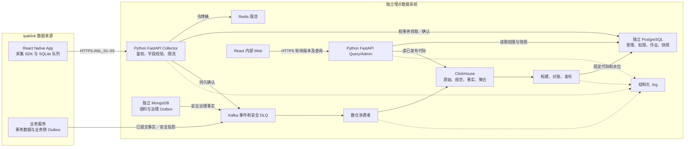

# ipaklink 埋点数据后台技术设计

版本 1.2 · 技术评审稿 · 2026-11-16

本设计覆盖[冻结功能清单 v4.1](./ipaklink-埋点数据后台功能清单.md)的 53 项功能。数据库字段与关联以[数据字典](./ipaklink-埋点数据后台数据字典.md)为基础，HTTP 和 Mock 以[API 接口文档](./ipaklink-埋点数据后台API接口文档.md)的 38 个独立契约为准。功能一次交付，实施可按依赖顺序联调。看板每 60 秒用 HTTPS 读取 ANL_10，仅快照版本变化时刷新。App 既有 IM 实时通道继续服务聊天业务。

## 0. 独立系统的交付边界

埋点后台是独立建设和部署的数据系统。它拥有自己的 Python 服务、React Web、数据库逻辑空间、服务账号、发布流程和运维监控。ipaklink App 是当前行为数据来源。App 内的采集代码负责监听生命周期、导航与业务回调，按既有事件契约记录、离线缓存和上报。

|归属|职责|交接边界|
|---|---|---|
|独立埋点系统|采集接口、限流、Kafka 消费、分析存储、指标计算、运营看板和治理作业|通过 HTTPS 接收行为事件。通过 Kafka 或受控业务接口接收已提交业务事实和安全维度。|
|ipaklink App|嵌入采集 SDK，回调提供页面、可见性、搜索、询盘、聊天和翻译的约定字段|App 以 ANL_01–03 接入。埋点初始化、失败重试及队列处理与 App 业务逻辑解耦。|
|ipaklink 业务服务|处理原有登录、询盘、视图、聊天、翻译等功能，保留权威数据及其成功语义|业务服务或其侧适配器发布已提交事实。必要对账通过受控业务接口或最小字段投影完成。|

埋点后台的 Repository 仅操作独立系统授权的表、集合及 Topic。既有业务表在数据字典中用于定义输入投影，原字段和原存储由业务服务维护。需要回查已提交事实时，由业务侧适配器查询并输出安全投影，分析服务不持有业务主库账号。逻辑隔离使用独立 schema/数据库、服务账号及 Topic ACL，生产是否复用物理集群由容量与运维评估决定。埋点后台停止或不可用时，ipaklink App 继续处理原有业务，行为事件按本地队列策略重新发送。

## 1. 技术栈与部署单元

### 1.1 技术选型

|层|选型|使用方式|
|---|---|---|
|App|React Native、TypeScript、现有 React Navigation 与 `@op-engineering/op-sqlite`|导航与 AppState 负责会话及页面可见性。业务回调产生显式事件。独立 SQLite 队列保存冻结字段。|
|内部 Web|React、TypeScript、Vite、React Router、TanStack Query、Ant Design、Apache ECharts|独立 React 应用。使用表格、筛选和图表呈现后台功能。按 OpenAPI 生成 TypeScript DTO，MSW 复用契约样例做 Mock。|
|Python 服务|Python 3.12、FastAPI、Uvicorn、Pydantic v2、PyJWT|FastAPI 提供版本化 HTTP API 和 OpenAPI，Pydantic 校验 DTO 和事件负载，领域规则由应用层执行。|
|数据驱动|Psycopg 3 + psycopg_pool、clickhouse-connect、PyMongo、redis-py、confluent-kafka|PG 显式事务和参数化 SQL，ClickHouse 批量写入与固定模板查询，MongoDB 同库 Outbox，Redis 令牌桶和缓存，Kafka 投递回调与手动位点提交。|
|数据平台|PostgreSQL、ClickHouse、MongoDB 副本集、Kafka、Redis、对象存储|独立系统的 PG 管受理、权限和控制数据，ClickHouse 管分析事实与报表，MongoDB 管独立系统的语料治理集合，Redis 管限流与缓存。原业务消息和翻译内容由业务侧 MongoDB 承载。对象存储承载授权导出及受控文件引用。|
|观测|Python logging、JSON Lines `.log`、OpenTelemetry Python、Prometheus 兼容采集|每个进程独立输出结构化文件日志，指标及追踪按 requestId 和 traceId 关联。|

Python 3.12 是本设计的运行时基线。Python 依赖写入 `pyproject.toml` 并锁定，Web 使用独立锁文件，镜像固定构建版本。当前工作区可核实的是 React Native 工程，Python 埋点后台和 React Web 属于待实现部分。既有业务服务通过其 API、Kafka 和权威库适配器接入。生产拓扑、SSO 参数和依赖版本在联调环境确认。[FastAPI 并发模型](https://fastapi.tiangolo.com/async/) · [Psycopg 连接池](https://www.psycopg.org/psycopg3/docs/advanced/pool.html) · [ClickHouse Python 驱动](https://clickhouse.com/integrations/python) · [PyMongo 事务](https://www.mongodb.com/docs/languages/python/pymongo-driver/current/crud/transactions/) · [redis-py](https://redis.io/docs/latest/develop/clients/redis-py/)

### 1.2 代码与进程边界

同一 Python 包共享领域规则和数据适配器，API、消费者与作业按进程独立扩缩。采集、查询和业务调用使用独立的连接池与超时。消费者与作业使用独立并发配额。

|进程|入口与责任|存储访问|
|---|---|---|
|analytics-api|Uvicorn 运行 FastAPI。Collector 与 query/admin 可分别部署并由网关按路由转发。|PG 受理/控制/作业、Redis 限流与报表缓存、Kafka 输入生产、ClickHouse 已发布结果只读|
|analytics-consumer|消费 App 和业务事件，校验、规范化并批量持久写入；维护分区位点和安全 DLQ。|Kafka 分区读取与 DLQ 写入、ClickHouse 原始与规范层写入|
|analytics-jobs|Outbox 转发、构建及发布、回放、对账、清理、导出、告警、语料作业。重任务按队列隔离。|PG 控制作业、MongoDB 受限作业集合、ClickHouse 构建和对象存储；分角色权限|
|业务服务|继续处理询盘、消息、浏览、翻译同步、注册和收藏，产出允许的已提交事实。|各自业务库与事务 Outbox|
|analytics-web|内部控制台。以公开的接口契约生成请求类型和 Mock，不连接数据服务。|HTTPS 访问 API|

后端使用 `backend/src/ipaklink_analytics/{api,application,domain,ports,infrastructure}`，入口为 `ipaklink_analytics.api.main:app`、`ipaklink_analytics.consumer` 和 `ipaklink_analytics.jobs`。Web 使用 `web/src/{routes,features,api,mocks}`。依赖方向为 api → application → domain，ports 定义数据库和消息接口，infrastructure 实现适配器。FastAPI 请求校验异常通过注册的处理器映射为契约的 HTTP 400 和 `{code,message,data}`，OpenAPI 同步声明该响应。数据库与内部 Python 字段使用 snake_case，HTTP 和 Kafka DTO 使用 camelCase。

### 1.3 并发与连接生命周期

- FastAPI lifespan 初始化并关闭 Psycopg `AsyncConnectionPool`、`redis.asyncio` 客户端和 Kafka 生产适配器。PG 使用显式 `conn.transaction()`，离开事务并释放连接后才等待 Kafka 或其他远端写入。
- HTTP 路由使用 `async def`。同步 ClickHouse 查询和必要的 PyMongo 调用提交至独立有界线程池，由存储端设置执行超时及资源限制。HTTP 超时后仍在运行的线程须占用并发配额至实际结束。批量计算、导出、回放和语料作业在独立进程执行。
- `confluent-kafka` 生产者由专用轮询线程驱动投递回调，再以线程安全方式通知对应 asyncio Future。消费者关闭自动提交和自动位点存储，持续 poll，手动提交已持久化的下一个位点。分区撤销后停止推进已失去所有权的位点。队列满与确认超时按 retry 契约处理。[Confluent Python 客户端](https://docs.confluent.io/kafka-clients/python/current/index.html)

## 2. 分层架构

|层|负责|关键输出|
|---|---|---|
|入口层|鉴权、请求 ID、受控解析与压缩上限、限流、参数绑定、HTTP 错误映射|统一 `{code,message,data}`、`X-Request-Id`、逐条接收结果|
|应用层|业务流程、事务开关、授权决策、写入幂等、作业编排、查询成本预算|稳定写操作结果、快照对象、任务状态|
|领域层|事件白名单与版本、会话边界、F01/F02、曝光与停留、留存、质量口径|纯规则及可复算指标语义|
|数据访问层|同库事务、出站领取、消费位点、查询模板和数据集发布|可靠持久化和可追溯的数据来源|
|展示层|按权限展示菜单、统一筛选、分页和空/错/延迟态|同屏使用唯一 snapshotId；作业按状态轮询|

## 3. 客户端采集与入口

1. 复用项目导航和业务回调。页面进入需叶子页可见，停留用单调时钟累加前台可见片段，短时切后台暂停并保留访问 ID。切换身份时新建会话和 `identityEpoch`，旧队列按来源身份隔离。列表卡片曝光按已确认的可见规则执行。当前 API 的连续 50% 面积且 1 秒是设计值，阈值和位置字典评审后进入 App 发布配置与事件版本。
2. App 先写 SQLite 再发送。按身份分批，默认每 10 秒或累计 20 条触发一次，单批至多 100 条、解压后 256 KiB、单条 8 KiB。断网恢复和上报失败采用指数退避及随机抖动。429 满足 Retry-After。队列默认 7 天窗口，到期丢弃并记录安全数量。
3. Collector 先根据入口和可信代理链识别边缘来流，执行请求级限流和大小限制，再验凭据、解析批次、按条校验字段和时间窗口、扣减事件配额、确立受理记录。各事件结果按请求序号返回。服务端计算 `actorKey`，拒绝 App 自报业务成功或主体身份字段。
4. 批次合法时可混合 `accepted/duplicate/rejected/retry`，客户端逐条清理或保留。认证失败、整批超限、限流失败在批次层处理。埋点线程和采集状态不得阻塞既有业务交互。

## 4. 事务、一致性与异步处理

### 4.1 事务矩阵

|操作|本地事务边界|外部操作与成功条件|
|---|---|---|
|客户端事件受理|PG 短事务锁定或插入 `analytics_ingest_receipt`，固定身份、模式版本、规范时间、摘要和有效租约|事务提交后发送 Kafka。Broker 确认后用租约条件更新 published，成功后才回 accepted；无法确认持久状态则回 retry。|
|PG 业务事实|由业务侧在其事务内持久化原操作及安全 Outbox，或复用既有业务事件。不跨到埋点系统的 PG 开事务。|业务侧 Relay 或适配器从既有消息或已提交行生成安全投影，然后发送 Kafka。持久确认后标记已发或推进位点。|
|MongoDB 业务事实|原消息或同步状态由业务侧 MongoDB 与其安全 Outbox 同事务写入。埋点系统的独立 MongoDB 负责语料本地事务，使用事务级 majority 写确认。|各自事务外发送 Kafka。业务键和 Outbox eventId 都有唯一约束，重试复用同一逻辑事实 ID。|
|创建修复、导出、授权、语料作业|幂等记录、业务写入、需要的审计记录放在所属权威库同一事务。跨库审计镜像走受控 Outbox。|写入返回约定的 200/201/202 和稳定资源 ID。报表文件写在事务外，校验产物后用状态/租约条件发布引用。|
|发布或回切快照|PG 序列化发布者，检查当前快照期望值，原子切换 snapshot 与关联的构建版本，并记录审计|ClickHouse 先生成和校验数据，PG 只提交指向合格且可读代际的指针。查询使用已提交快照。|
|删除与撤回|先在权威库持久化 tombstone/清理任务和抑制规则|异步清理 ClickHouse 明细和受影响派生数据并回查，回放及备份恢复先应用抑制清单。|

PG 常规事务使用 Read Committed，使用唯一键和条件更新保障并发。领取任务可用 `FOR UPDATE SKIP LOCKED`，只用于队列领取。先更新租约后提交，网络调用在提交后执行。MongoDB 多文档事务使用明确的事务级写确认配置。跨库业务，例如询盘和 MongoDB 询盘卡片，遵守各自已有业务成功条件，通过稳定业务键及可重试步骤收敛。卡片补写不重发询盘成功事实。[PostgreSQL 锁定子句](https://www.postgresql.org/docs/current/sql-select.html) · [MongoDB 事务写确认](https://www.mongodb.com/docs/manual/reference/write-concern/)

### 4.2 入口幂等和 ACK

- 业务事实 eventId 根据生产域、事实类型、稳定业务键和状态版本派生。App eventId 在端侧第一次入队时生成。入口对授权身份及事件语义字段做规范化摘要，使用稳定的 JSON 规范化配置。相同 ID 不同身份或语义负载返回 eventIdConflict，禁止把后到负载覆盖为原事件。
- 重试复用首次规范化记录。服务端要保存可重建的不可变安全信封，发生时间、业务日期、收件时间、身份和模式版本不可随重试改变。传输级追踪 ID 可以变化，其字段须排除在语义比较之外。接入映射的保留时间覆盖客户端重试与 Kafka 允许回放范围。
- 幂等状态只有 `pending → published`。已 published 且同负载，回 duplicate；已有有效租约回 retry；租约过期允许同事件尝试再次生产。Broker 已写但 PG 确认丢失时，重试可能产生多条 Kafka 投递，数仓按逻辑事件 ID 去重。
- 标有 Idempotency-Key 的资源创建接口按「认证主体 + 操作代码 + 键」隔离，保存语义摘要和成功资源 ID 或成功响应。相同主体、操作和键复用原结果，异负载返回 409。请求仍在处理中时返回可重试 409，调用方不得换键重试。版本更新用 `expected*` 作为乐观锁，重复置位按各接口的状态规则返回。

### 4.3 Kafka 消费、回放与发布

- 保留 `analytics.event`、既有 `inquiries.created` 和安全 DLQ。App 按 sessionId 排序，业务事实按 aggregateRef 分区。消费者按分区内连续完成的位置提交，允许分区间独立推进。生产基线为副本 3、min ISR 2、持久 ACK 与幂等生产者。消息在跨库、重启和回放场景仍按至少一次传递设计。[Apache Kafka 生产者配置](https://kafka.apache.org/44/configuration/producer-configs/)
- 消费者写 ClickHouse 后才推进位点，需等待可校验的持久写入确认。若使用异步插入，开启等待写入确认；若使用分布式入口，等待目标写入和配置的副本确认，避免只确认本地缓冲。临时故障暂停对应分区并退避，确定永久失败先写安全 DLQ 再推进。广播和回放均禁止未授权读取原始正文。
- 构建输入取各分区已持久化连续水位，保留源坐标，按 eventId 选择首次可信语义版本后生成事实、聚合和对账。ReplacingMergeTree 整理历史重复记录，发布作业仍显式去重。迟到事件重算受影响日期，并纳入 F01 24 小时、F02 15 分钟、24 小时回复与 D1/D7/D30 所需的相邻时窗或首活日期。[ClickHouse 去重语义](https://clickhouse.com/blog/common-getting-started-issues-with-clickhouse)
- 报表快照以 PostgreSQL 关系表 `analytics_report_snapshot_build` 为权威：同快照同数据集同日只指向一个 generation。先生成各分区结果，再核验来源数、分母、校验摘要、生成代际跨查询节点可见性。发布事务拿快照级锁，更新状态与关联，失败保留已发布版本。读端同一次请求先解析当前/指定 snapshotId，再按那一代查询。旧版只有未过期且未因数据清理失效时可回切。

### 4.4 开发前补齐的物理字段

以下为技术实现选择，需要在迁移时同步回数据字典。已有公开接口字段继续使用既定契约。

|对象|落点与约束|
|---|---|
|受理重发|`analytics_ingest_receipt` 新增 `canonical_payload jsonb` 保存不可变白名单信封。生成、获取租约及记录摘要同事务。TTL 到期后按受理策略清理，长期回放由数仓受控执行。|
|PG 通用创建幂等|新增 `analytics_idempotency`，主键 `(principal_id,operation_code,idempotency_key)`。列包括 request_hash、resource_ref、response_code、expires_at。修复作业既有唯一键可继续复用。导出和授权创建与通用幂等行同事务。|
|MongoDB 作业幂等|在 `corpus_jobs` 增加 operatorId、operationCode、idempotencyKey、requestHash，建立复合唯一索引；以同事务写入匹配的安全审计/出站记录。|
|跨库审计|语料操作若由 MongoDB 提交，同库写入唯一 auditId 的审计事实与 Outbox，PG 审计表按 auditId 幂等落库。审计查询可能暂时落后。受控读取要求先完成审计的持久写入，审计不可用时拒绝访问。|
|告警投递|在 `analytics_alert_delivery` 增加可空 `fact_code` 或记录可重建的安全上下文，保留 `alert_key + channel_code + destination_ref` 唯一约束。外部渠道支持幂等键时复用投递 ID。|

## 5. Redis 限流、缓存与前端状态

### 5.1 入口限流

采用令牌桶与 Redis Lua 原子脚本。配置作用域为环境 × 路由 × 安装/主体/IP 假名；后台按操作者和查询成本另计。网络边缘按可信代理链识别来源，不信任客户端提供的任意转发头。匿名安装或主体验证后扣细粒度配额。各桶分别原子更新，跨桶不做回滚事务。全局配置的键前缀、窗口及桶容量独立于现有业务 Redis 计数。Redis 入口故障时采集返回可重试 503，客户端保留原队列。[Redis 令牌桶](https://redis.io/docs/latest/develop/use-cases/rate-limiter/redis-py/)

### 5.2 缓存设计

|对象|缓存键、位置和初始 TTL|失效与故障处理|
|---|---|---|
|事件模式和已生效策略|进程内缓存按 eventName + schemaVersion + source、policyVersion 读取；生效指针缓存 15 秒，App 配置按 configTtlSeconds。|管理员发布后主动刷新；进程内多实例 TTL 兜底。全局关停在入口按专用生效标志检查，关停配置失效按拒绝新增上报处理。|
|快照元数据 ANL_10|PG 当前快照索引直读，前端按会话缓存并每 60 秒轮询。|普通页面新请求发现快照变更后刷新。携带已过期 ID 回 409，先刷新元数据再重查。|
|报表数据|Redis 独立缓存连接池。键包含环境、端点、规范化筛选、snapshotId、metricVersion、主体权限作用域指纹和抑制版本，默认 TTL 60 秒加抖动。|授权在缓存前校验，权限变更或数据清理推进鉴权/抑制版本。发布使用新快照键。缓存不可用且依赖健康时限流回源 CH；回源超限或超时回 503。|
|受控会话、审计、作业状态、下载 URL|服务端无共享结果缓存，HTTP 私有敏感响应 `Cache-Control: no-store`。|每次读检查当前权限与工单。状态由权威作业表返回。已撤销的授予不因缓存继续生效。|
|前端查询|TanStack Query key 包含账号范围、资源、快照、日期和筛选；表格按 `page/size` 查询。|切换账号清空敏感状态。快照或筛选变化后取消旧请求或忽略过期响应；保留旧值时标明水位。|

同一缓存键采用实例内 singleflight 合并并发回源。普通报表有独立查询并发和超时。带暂缺分母或未成熟的字段返回 null，真实计数为 0，平台接口统一输出状态字段。导出使用固定快照和权限范围，重跑白名单查询；生成文件到期后删除对象并更新作业状态。

## 6. 鉴权、授权与内容隔离

### 6.1 身份与权限模型

|入口|认证方案|授权与约束|
|---|---|---|
|App 已登录|复用既有 access token 和认证中间件|由验证身份派生 actorKey，按采集策略和 epoch 核验。App token 只允许面向 App 的接口。|
|App 匿名|ANL_02 签发独立用途短时 token，建议 15 分钟|绑定 installId、identityEpoch、环境、audience 和用途。Collector 校验与请求一致。匿名凭据不能使用后台路由。|
|后台 Web|复用企业 SSO，OIDC 授权码 + PKCE，后台 access token 仅保存在会话内存|FastAPI 鉴权依赖使用 PyJWT 验签，校验 iss/aud/exp 和存在时的 nbf，固定算法白名单，仅接受预配置 issuer/JWKS。403 对已认证但无角色、数据范围或工单的请求。|
|后台内部服务|工作负载身份与 TLS，Kafka SASL/TLS 和 Topic ACL，服务间按已有生产规范认证|Collector 只有输入写权限，数仓读输入及写安全 DLQ，查询服务只读已发布数据。数据库角色按分工配置。|

SSO 后台主体映射 `analytics_access_grant.principal_id`，授权以角色权限与行级 regionId、datasetCode、ticketId 范围为交集。工单校验还要绑定操作、有效期与目标对象。UI 菜单只负责展现，API 对每次读写重新鉴权。发布、回滚、授权、撤销、敏感读取和语料操作记录安全审计。403 只返回稳定错误码。后台跨站请求仅允许预配置源。[OAuth 安全实践](https://www.rfc-editor.org/rfc/rfc9700.html) · [JWT 签发方和受众校验](https://www.rfc-editor.org/rfc/rfc8725.html)

### 6.2 数据与文件保护

- App 上报字段、Kafka 分析信封、仓库和 .log 在入口按白名单阻断正文、凭据、联系方式、原词及附件内容。主体及会话安全引用使用分域 HMAC，密钥按环境隔离与轮换；生成时带密钥版本的安全映射支持重放、清理与过渡期匹配。
- MongoDB 内容仅授权业务或语料服务访问。看板查询、导出与统计不复制聊天、翻译或语料原文。仓库小基数压制和数据范围规则应同时应用于 UI、导出及缓存，避免通过分组和总计反推。
- 导出对象默认私有，ANL_25 验证当前授权后返回同源短时下载 URL，由下载网关再次核验主体、快照和作业有效期再流式读取私有对象。URL 短有效期，作业失效返回 410，下载与拒绝均可审计。
- 账号/语料撤回先设抑制规则，冻结受影响快照查询并清理导出产物或其有效授权，再重建涉及的时间窗和快照。故障恢复后复核抑制清单，过期或含已清理数据的快照不能重新发布。

## 7. 看板、后台作业与读路径

|功能模块|计算或执行|接口与追踪|
|---|---|---|
|经营总览、页面、功能、留存|查询固定 ClickHouse 模板，按业务日期及角色范围汇总。跨日 UV 再去重，P95 合并分位状态或重读事实，比例重算分子分母。|ANL_10–15；按 snapshotId、metricVersion 检查口径|
|F01/F02|F01 详情锚点计 24 小时逐步归因，询盘业务量按 PG 提交日期独立返回。F02 按同一有效 searchId、企业或产品目标和 15 分钟窗计数。|ANL_14；ANL_17 对账可区分未归因与漏事实|
|列表曝光与 CTR|达到连续可见阈值后生成 impressionId。按页面、列表请求和卡片身份去重，匹配点击后同曝光最多贡献一次 CTR 分子。|ANL_03、23；EVT_25/26 契约由 API 评审后登记|
|受控会话|按工单和归属数据范围获取安全事件，按时间、序号及稳定键分页。|ANL_16；落访问审计|
|修复、导出、语料、告警|通过 PG/MongoDB 作业队列独立执行。状态 queued → running → succeeded/failed，带租约、次数、失败码。高成本作业设并发和分段处理。|ANL_18/19、21/22、24/25、32/33、39–42；后台详情默认每 3 秒轮询至终态|
|采集与访问管理|事件 schema 和策略单版本发布，按期望版本更新。通过授权与审计接口控制回滚、撤销和治理。|ANL_26–31、34–38、43–45；记录期望版本及审计 ID|

## 8. 运维、容量与测试

### 8.1 运行基线

计量和时效数字为初始设计值，压测后冻结。初始基线为采集入仓 P95 不高于 2 分钟、质量数据 5 分钟、经营报表 P95 15 分钟、常用查询 P95 2 秒。在线查询先使用 5 秒硬上限，导出、修复、语料处理独立执行。记录采集各状态比例、Kafka lag 和低 ISR、Outbox 最老未发时长、ClickHouse 写入错误率、查询 P95、快照生成延迟以及业务差值。连续两个周期超过阈值时，记录安全告警并通过配置渠道通知。

容量估算以 1 万 DAU、60 事件/人/日、1 KiB/事件为例，原始约 0.57 GiB/日，90 天约 51.5 GiB 单副本未压缩。按峰值系数 20、重试倍数 2 估算入口约 278 事件/秒；压测还要包含匿名、卡片曝光突发、缓存冷启动及同窗回放。PG 受理连接与事务池、Kafka 分区、CH 批插批次、MongoDB 副本和 Redis 命名空间按实测拆容量。

### 8.2 日志与回滚

所有组件输出结构化 JSON Lines 到 `.log`，字段包含 ts、level、service、env、requestId、traceId、action、resultCode、durationMs 和 count。消费者可记录 topic/partition/offset。日志按日或 256 MiB 轮转，每进程独立文件写入，普通日志建议保留 30 天，审计镜像建议 180 天。OpenTelemetry 追踪跨 HTTP、Kafka 和作业传递，Prometheus 指标避免高基数主体和请求 ID 标签。采集、消费和查询均支持独立开关与熔断。回滚先停止新策略或构建的发布，再切回经过校验可见的快照，Kafka 位点和受理记录按追踪证据处理。[OpenTelemetry Python](https://opentelemetry.io/docs/languages/python/instrumentation/)

### 8.3 验收矩阵

|案例|故障/输入|必须观测的结果|
|---|---|---|
|受理幂等|Kafka 已收到，PG 确认前进程退出；随后同 ID 补报|最终只产生一条指标事实；不同负载同 ID 拒绝；旧租约确认失败|
|事务与跨库|MongoDB 事务提交结果未知，PG 询盘成功后卡片重试|消息与其 Outbox 一次业务事实，询盘成功 PV 无重复；可按稳定 ID 对账|
|分区恢复|一分区一个失败位点，另一个分区正常|失败分区不跳读已失败位点；永久失败落 DLQ 并确认后推进，其余分区继续|
|发布回切|新代际缺一分区或 PG 切换失败|旧快照仍可用，查询无混代；修复后版本更新可观察|
|授权与缓存|同筛选不同角色、撤销工单、主体清理后重放|无串权限；敏感读取拒绝；失效快照及文件不可读；已清理主体不复活|
|卡片与转化|快速滑动、虚拟列表复用、同一次曝光多次点击|阈值以下不计，稳定曝光实例不重计，CTR 分子最多一次|
|Mock 与接口|分页、空数据、401/403、409、429、503 和异步任务失败|格式一致，前端能不连接真实后端展示渲染分支，关键流再用真实服务验收|

接口契约测试使用 pytest + HTTPX 验证状态码、鉴权、分页及错误包。集成测试连接真实测试数据库和 Kafka，复核驱动事务、ACK、重新分配与位点恢复。Web 用 Vitest、React Testing Library 与 MSW 验证筛选、快照及异常状态。

## 9. 实施依赖和评审结论

1. 冻结数据字典增量迁移、SSO issuer/audience 和角色映射、卡片可见阈值、Kafka 资源及数据保留期限。确定已有询盘 `dialogId/sessionId` 与成功状态的适配边界。
2. 前端依 API 完成 Mock，后端先跑通采集、询盘事实、仓库和一个看板查询，建立故障注入与对账样例。
3. 复用相同事务、鉴权和发布机制完成全部查询和管理能力。通过表中的故障和防串权限测试后，对 53 项功能逐条留验收证据。

本次文档确定了技术方案、数据访问边界和默认值。未部署服务、执行数据库迁移或运行线上压测。新增字段及索引、SSO 对接、卡片阈值和基础设施参数需在技术评审和联调中落定。

