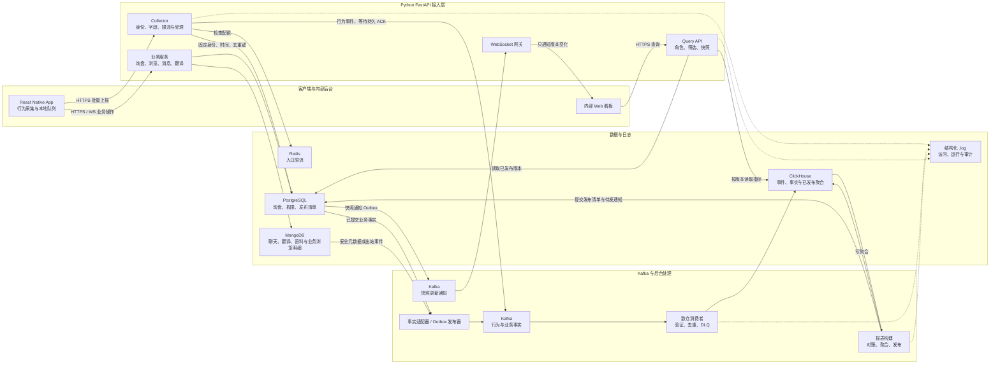
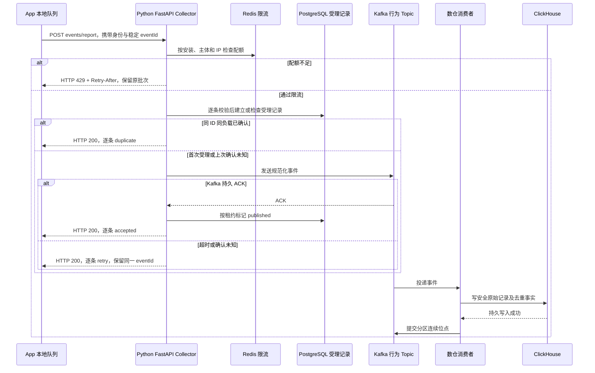
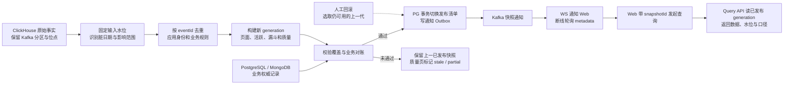

# ipaklink 埋点数据后台详细设计

版本 2.0 · 研发评审稿 · 2026-11-13  
配套交付《ipaklink 埋点数据后台接口文档》。本文定义采集、存储、统计和看板，接口文档定义调用、字段和消息协议。下文的限流、时效和留存值为首版设计基线，需用业务量和压测结果校准。
独立部署与数据访问边界以[技术设计 v1.2](./ipaklink-埋点数据后台技术设计.md#0-独立系统的交付边界)为准。ipaklink App 嵌入采集 SDK，既有业务服务经 Kafka 或受控接口提供安全事实，埋点服务使用独立的数据空间与账号。

本次开发统一交付 [冻结功能清单 v4.1](./ipaklink-埋点数据后台功能清单.md#2-功能全清单) 的 53 项功能。HTTP 联调、分页及 Mock 使用 [本次 API 接口文档](./ipaklink-埋点数据后台API接口文档.md)。下文的既有范围标记和旧接口示例用于查阅原技术设计。


## 1. 建设范围与现状

功能拆分、优先级与验收见《ipaklink 埋点数据后台功能清单》。HTTP、Kafka 和 WebSocket 的联调契约见《ipaklink 埋点数据后台接口文档》。

|业务问题|后台必须回答的问题|首期交付|
|---|---|---|
|流量与活跃|今天多少登录用户在用，哪些版本或地区有变化|总览、活跃与留存、页面分析|
|找供应商|搜索是否有结果，用户在哪个步骤离开，最终产生多少询盘|搜索与供需漏斗，业务总量及归因覆盖|
|站内沟通|多少用户打开会话、发送成功及收到首次人工回复|消息使用及回复指标|
|多语能力|各翻译模式和语言对有多少使用、失败集中在哪里|翻译分析和技术错误下钻|
|数据可信度|上报何时到达，重复、漏报、对账偏差是否影响图表|数据质量页、回补与版本切换|
|受控排查|经授权复核一条会话路径或内容治理任务|P1 会话时间线、语料汇总与作业状态；P0 建立权限和审计基础|

### 1.1 代码与文档的接入依据

|核对点|当前材料与实施动作|
|---|---|
|客户端交付范围|工作区包含 `ipaklink-main` React Native 工程和客户端测试。Python 服务、Kafka 集群和数据后台按待建设设计，部署状态及后端 DTO 需联调核实。|
|导航与诊断|`App.tsx` 已调用 `track('screen_view')`，读取根层路由。改接导航树最深的白名单页面，使用 `onReady`、状态变化和前后台状态配合。`src/services/telemetry.ts` 的默认行为跟踪只在开发环境打印，异常另发 `/telemetry/client-errors`。客户端诊断通道需单独清洗错误上下文。|
|入口|`src/navigation/tabs/BottomTabs.tsx` 的 Home、Message、Translate、Interaction、Me 映射为一级入口；HomeStack、MessageStack、TranslateStack 提供子页面。页面编码由注册表维护，路由改名通过映射兼容。|
|搜索|`src/services/api.ts` 的搜索请求提供请求/结果边界，`globalSearchStore.ts` 的历史保持端侧。结合 SearchScreen 与全局搜索实际结果卡片回调建立请求、结果打开和详情关联。|
|询盘|`InquiryEditScreen.tsx` 已发送 `clientRequestId`，客户端读取 `dialogId`，接口附件示例返回 `sessionId`。联调统一 DTO 或显式映射；新增可选 `contactFlowId`，以 `inquiries.created` 对应已提交记录作为成功事实。|
|浏览|`api.ts` 已有 `viewApi.report`。业务依据为 `POST /views`、MongoDB `company_view_raw`、Redis 计数及 PG 冷备列。行为页面 PV 和业务实体浏览 PV 分别按各自事实计算。|
|聊天|`api.ts` 的消息写接口与 `realtime.ts` 的实时通道继续承接现有交互；`chatOutbox.ts` 已处理业务离线补发。分析仅在消息持久化成功后记一次事实。|
|翻译|`onDeviceTranslate.ts` 和各翻译页面提供本地任务边界，`api.ts` 提供记录同步。原文/译文遵循端侧 SQLite 与 MongoDB 业务同步路径，翻译完成与同步完成分开计数。|

## 2. 板块一 采集什么数据

### 2.1 公共字段及标识

|字段组|必需字段|粒度与使用|
|---|---|---|
|事件|eventId、eventName、schemaVersion、occurredAt、receivedAt、source|一次逻辑事件。App 随机 UUID；服务端对业务事实用稳定业务键派生 UUID。重试、重放保持 eventId 与规范化负载。|
|会话|installId、sessionId、sequence、identityEpoch|App 事件必填。安装 ID 随机生成，按安装保存。序号从 1 开始，按会话单调递增。账号边界更换 epoch 和 sessionId。|
|身份|identityType、actorKey、anonKey|Collector 根据认证上下文生成，分析身份与真实账号 ID 隔离。登录账号跨端使用相同假名；匿名按安装和匿名阶段计算。|
|页面|screenName、pageViewId、entrySource|页面事件必须包含稳定叶子页与访问实例。业务点击可携带当前实例作为来源。|
|设备与地域|platform、appVersion、appLanguage、regionId|iOS/Android、版本、界面语言和配置地区。地区采用既有字典或 unknown，保留事件发生时快照。|
|关联|searchId、contactFlowId、clientRequestId、taskId、dialogRef、实体 ID|按事件白名单使用。App 浏览的企业/产品 ID 由已加载业务对象取得。服务端可验证的关系以业务数据为准。|
|处理|requestId、producer、payloadHash、ingestBatchId、policyVersion|用于批次追踪、冲突检测、审计和回放；运营查询默认隐藏。|

登录前队列与登录后队列按 epoch 分区。匿名批次始终按匿名上传；已登录批次只用同账号且有效的授权重试，切号后冻结旧队列，过期清除。匿名活跃与登录活跃分别发布，首版不回填匿名历史到登录账号。跨登录边界的询盘归因单列为未归因。身份生成使用按环境隔离的 HMAC，服务端从已验证主体生成，不接受 App 自报 actorKey。密钥轮换通过带版本映射和仓库重算保持指标连续性。撤回采集时清理端侧待报队列，入口与回放执行同一有效策略。

### 2.2 事件字典与触发点

字段后的 ? 表示可省略。时长为非负整数毫秒，结果数为非负整数，错误仅使用固定枚举。行为和事实的优先级均以该表为准。

|事件 / 优先级|唯一触发条件及来源|专用字段|用于分析|
|---|---|---|---|
|app_session_start / P0|App 启动或前台恢复时实际建立新会话|launchSource|会话量、入口|
|app_background / P0|从 active 转到非活跃，仅记录一次|无|前后台与路径诊断|
|screen_view / P0|稳定叶子路由首次前台可见|entrySource|PV、UV、路径起点|
|screen_exit / P0|页面退出、会话切换或正常可知的访问结束|visibleMs、exitReason|停留与闭合覆盖|
|search_submit / P0|提交后实际发出新搜索，翻页沿用 searchId|searchId、scope、queryLengthBucket、filterCount|搜索发起量|
|search_result / P0|首次结果页确认返回或确定失败|searchId、scope、outcome、resultCount?、latencyMs、errorCode?|零结果率、错误、延迟|
|search_result_open / P0|用户实际打开搜索结果卡片|searchId、targetType、targetId、position|结果点击率、位置分析|
|entity_detail_view / P0|企业/商品业务对象加载并可见，同一 pageViewId + 目标一次|targetType、targetId、companyId、productId?、searchId?、entrySource|详情曝光与归因|
|business_view_recorded / P0|业务浏览明细持久化后投递|viewRef、targetType、targetId|业务 PV 对账|
|favorite_changed / P0|业务关系确实变化后投递|targetType、targetId、action|收藏与取消次数|
|contact_supplier_click / P0|点击详情页联系供应商后创建唯一联系链路|contactFlowId、companyId、productId?|询盘漏斗第二步|
|inquiry_submit / P0|校验通过并调用创建接口，按 clientRequestId 记一次逻辑提交|contactFlowId?、clientRequestId、companyId、productId?|表单转化与提交人数|
|inquiry_submit_failed / P0|用户可见的失败结果，每次网络尝试独立|clientRequestId、attemptNo、errorCode|表单失败原因|
|inquiry_created / P0|PG 询盘最终提交，复用既有 Kafka 事实|inquiryRef、contactFlowId?、clientRequestId?、companyId、productId?|成功总量与归因|
|chat_session_open / P0|真实会话视图可见，排除示例/假会话|dialogRef、entrySource|会话打开与入口|
|message_send_succeeded / P0|Mongo 消息首次成功写入，业务系统写入的询盘卡片单独分类|dialogRef、messageRef、messageType、senderKind|发送成功、回复计算|
|translate_started / P0|本地任务真正开始，重试重新生成 taskId|taskId、mode、sourceLang、targetLang|翻译需求|
|translate_completed / P0|本地任务进入终态，只计首个有效终态|taskId、mode、sourceLang、targetLang、outcome、latencyMs、errorCode?|成功率、失败率、耗时|
|translate_sync_completed / P0|记录首次落 Mongo 或同步状态真实变化|recordRef、mode、outcome|同步质量|
|account_registered / P1|PG 成功注册后写事实|channel|注册与获客|
|notification_open / P1|从受控站内通知或推送点击进入|category|消息召回|
|message_translation_toggle / P1|原文/译文状态实际切换|displayMode|跨语沟通功能采用率|
|translate_copy / P1|译文复制成功|mode|使用深度|
|corpus_asset_status_changed / P1|治理作业的语料条目状态变更|datasetCode、languagePair、status、reasonCode?|语料治理与覆盖|

### 2.3 端侧采集和数据准入

- 以前台状态加实际叶子路由焦点判定页面可见。重复导航回调不计新 PV，同路由切换到不同实体新建访问。短时后台暂停单调时钟，30 分钟内返回同一页续记同一访问。后台超过 30 分钟则关闭旧访问、另起会话。应用异常退出且无可靠结算时标记未闭合，计 PV，停留分母排除；禁止用服务器接收时间猜测停留。
- 会话在冷启动、后台超过 30 分钟或身份变化时新建。会话最后有效页面在水位通过后判为退出；结束前发生多条业务事件仍只算一个退出页面。持续活跃用去重的有效前台页面或下列指定业务事件确认。
- SDK 将白名单事件落端侧 SQLite 独立队列。每批 1–100 条，默认 20 条或 10 秒触发，前后台切换时按系统可用时机尝试；队列最多 5,000 条或 10 MiB，最长 7 天，淘汰先处理过期、再处理低优先级最旧数据。队列记录只保存允许上传的元数据，按事件回执逐条删或重试。客户端诊断汇总上报累计淘汰数量，App 不持有 Kafka 凭据。
- 搜索只上传长度桶、范围和结果数量，不传关键词、聊天检索词、位置坐标、表单内容、附件信息、支付或联系明细。语言使用业务枚举，区分界面语言和翻译语言，未知为 `und`。入口及错误字段由字典控制，禁止填原始错误文本。
- 端侧时钟允许过去 7 天、未来 5 分钟。超出窗口的初次采集拒绝并计质量指标。首次通过网关规范化的时间、身份和业务日期随 Kafka 事件固定，回放沿用原值。离线历史只补上报窗口内记录，数据恢复回放使用内部权限和原始可信信封。
- 已登录和匿名上报均由采集策略控制。App 登录身份靠 Bearer，匿名凭据短期有效且绑定安装和匿名 epoch。身份/权限失效直接返回失败。用户 ID、设备指纹、完整 IP、密码、验证码、业务正文、原始文件、授权头不得进入 ClickHouse、行为 Kafka、DLQ 或普通日志。

### 2.4 存储分工与主要模型

|组件|主要存储|职责|
|---|---|---|
|PostgreSQL|既有 users、companies、products、inquiries；新增 analytics_event_schema、analytics_metric_def、analytics_report_build、analytics_repair_job、analytics_outbox、analytics_access_grant、analytics_subject_erasure、analytics_admin_audit|业务事实、配置和版本、出站发布、发布清单、权限及治理任务状态|
|ClickHouse|events_raw、events_canonical、fact_page_visit、fact_actor_active_day、fact_search、fact_inquiry_flow、fact_dialog_reply、fact_translate_task、dim_entity_safe、agg_metric_day、agg_retention_day、agg_quality_minute|明细、对账、汇总与看板；表字段采用 snake_case|
|MongoDB|既有 messages、各类 translate_records、company_view_raw；新增 corpus_datasets、corpus_items、analytics_mongo_outbox|聊天/译文/语料正文与受控元数据，消息事实或语料状态的可靠投递|
|Redis|采集限流键、查询限流键；沿用现有业务计数命名空间|流量入口和短时状态。分析事实依赖持久库，限流集群与业务计数按资源隔离。|
|Kafka|分析、业务事实、看板通知与 DLQ Topics|前后端异步数据交换的后台通道，解耦接入、处理、归档和查询。|
|日志文件|组件级 JSON Lines `.log`|运行诊断、质量追踪和审计镜像。业务数据和事件原始事实仍由各自存储负责。|

**PostgreSQL。** `analytics_event_schema` 主键 (event_name, schema_version)，保存 payload schema、来源和生命周期；`analytics_metric_def` 主键 (metric_code, metric_version)，保存口径、维度和查询模版编号。出站表以 event_id 为主键，带 aggregate_id、payload_safe、status、attempts、available_at、lease_until、created_at、published_at，建立待投递部分索引 (available_at, event_id)。`analytics_report_build` 保存 dataset、date_key、generation、源 offset 水位、输入快照、校验摘要；仅通过一条事务更新整个看板依赖的发布清单。修复表以 (job_type, idempotency_key) 唯一，记录申请人、范围、校验和和失败码。权限和审计分别存授权范围/到期、操作人/原因码/范围/结果/请求 ID。运维以服务角色访问，查询服务只读已发布清单。

**ClickHouse。** `events_raw` 粒度为一次投递，含 event_id UUID、occurred_at 和 received_at DateTime64(3,'UTC')、source、event_name、actor_key、session_id、schema_version、payload_hash、Kafka 坐标及安全属性；按接收月分区，排序 (received_at,event_id)。`events_canonical` 粒度为逻辑事件，保留初次接收的安全字段，使用 ReplacingMergeTree，按规范化发生月分区，排序 (business_date,event_id)，按 eventId 固定路由到同一 shard。构建时按受控日期和固定输入水位显式去重。重复 ID 内容冲突时保留首次可信入库数据并隔离冲突版本。PG 新增 `analytics_ingest_receipt`，以 event_id 为唯一键，记录 producer_scope、payload_hash、canonical_time、subject_epoch、发布状态和租约。保留期覆盖客户端重试与 Kafka 重放窗口，已进仓的内部回放用原始可信记录校验。数仓读视图在合并完成前仍提供一致统计，新增原始行须经去重构建后才进入正式指标。

|派生表|键或统计粒度|内容|
|---|---|---|
|fact_page_visit|page_view_id|发生日、归属用户、页面、访问时长、闭合、会话退出|
|fact_actor_active_day|business_date, actor_key, platform, app_version, region_id|身份分组、当日有效事件，供活跃；首次活跃由独立索引维护并供留存|
|fact_search|actor_key, search_id|首请求、首结果、结果打开、详情及首次点击耗时|
|fact_inquiry_flow|actor_key, contact_flow_id|点击、提交、归因候选、业务 ID、各步时刻；无归因事实另存业务总量|
|fact_dialog_reply|dialog_ref, anchor_message_ref|人工对话发起、对侧首次回复、延迟和观察状态|
|fact_translate_task|actor_key, task_id|发起、首个终态、模式、语言对、耗时|
|agg_metric_day|generation, date, metric, dim_set, dim_values|可加数量、分子分母、精确用户集状态或独立区间去重及分位聚合状态|
|agg_retention_day|generation, cohort_date, offset_day, cohort_dim|cohort_size、retained_count、成熟状态|
|agg_quality_minute|时间桶、服务、来源、版本|受理、拒绝、限流、晚到、重复、offset、对账结果|

同一批发布的派生表以独立 generation 构建。先校验再切换 PG manifest，读请求绑定一个版本，回滚直接换回仍在保留窗口内的上一代。数据修正或迟到触发日期重算，同日访问退出和跨日会话重新派生，询盘回看 24 小时锚点，留存依赖首次活跃及后续 D1/D7/D30。首次活跃索引随删除和回补维护，长期保留期不能只靠 90 天明细反推。

**MongoDB。** 消息与译文沿用业务权限、撤回和仅对我删除语义。语料 `corpus_datasets` 记录 datasetCode、purposeCode、版本、允许语言、保留期和状态；`corpus_items` 记录 itemId、datasetCode、sourceRef、sourceLang、targetLang、文本或文件引用、脱敏版本、reviewStatus、consentRef/授权依据引用、createdAt、expiresAt、tombstoneAt。唯一索引 (datasetCode, sourceRef, revision) 防重复入库，(datasetCode, reviewStatus, createdAt) 支持治理查询。语料用途须单独配置，默认无聊天转语料作业；启用后依次校验授权、提取、脱敏、审核、入库，撤回授权按来源引用传播。正文只有授权的业务/语料服务读取。大附件保留业务文件引用。PG 询盘与 Mongo 卡片用可重试业务步骤和幂等键衔接，禁止跨库伪事务。Mongo 消息及安全 outbox 在同一 Mongo 事务，或从已持久化的变更流按持久 checkpoint 派生并保留补扫机制。

### 2.5 系统架构



图中有三条独立链路。App 行为经 Collector 写 Kafka，业务成功从 PostgreSQL 或 MongoDB 的已提交记录派生，Web 查询按已发布快照从 ClickHouse 读取。Redis 在入口扣配额，运行日志进入组件自己的 `.log`。MongoDB 中的聊天、翻译与语料正文由业务服务按权限读取，数仓仅接收允许的元数据。

### 2.6 批量采集时序与故障恢复



时序图以单条合法事件展示持久化边界。同一批可以同时包含 accepted、duplicate、rejected 和 retry。若 Kafka 已写成功但 HTTP 响应丢失，客户端以同一 eventId 补报，数仓仍只计一次。消费者发现确定无法处理的事件时，写已清洗的 DLQ 后推进位点。

- Redis 令牌桶按环境区分，键分匿名安装/登录主体/IP/查询角色。按可信代理链提取 IP 后 HMAC，不落原始 IP。首版建议请求维度 IP 120 次/分钟突发 60，安装 30 次/分钟突发 10；事件配额登录主体 1,200 条/分钟突发 200、匿名安装 600 条/分钟突发 100。单键 Lua 更新、Redis 时间补充配额，TTL 至少为两倍补满时间。多维度逐桶扣减，前序已扣配额不回滚。限流返回 429 和 Retry-After；Redis 不可用时行为入口返回可重试 503；业务接口使用独立策略。查询按角色和成本计费，单操作者默认 30 次/分钟、最多 3 个并行查询。
- HTTP 请求级错误先拒绝整个批次。事件逐条校验，只有 Kafka 持久 ACK 才回 accepted。首次受理先写 PG 身份/去重映射，ACK 后置为 published；崩溃后未确认记录允许重发同一消息。ACK 超时回 retry，允许 broker 已收到的同 ID 后续重投。客户端使用指数退避及随机抖动，429 先等 Retry-After。为避免伪造排队身份，队列上传使用同一账号的认证和原始 epoch。
- Kafka 默认 RF=3、min ISR=2、acks=all、幂等生产者，消费按至少一次处理。App 事件分区键为 sessionId，服务端为 aggregateRef，跨分区用关联键及事实时间确定顺序。按分区推进连续 offset，持久写入成功才提交；暂时错误暂停分区指数退避，永久结构错误写入已清洗 DLQ 后提交。回放审批、试跑、限速、对账，保留 eventId 和原始坐标，生成新 runId。超出 Kafka 保留窗口走批准的 ClickHouse 原始层回补。
- 所有应用、访问、错误、采集、消费、查询、对账、重放与审计镜像落 JSON Lines `.log`。路径示例 `logs/analytics/collector/ingest-20261113-001.log`，每条包含 ts、level、service、env、component、requestId、traceId、action、resultCode、durationMs、count，消费者可附 topic/partition/offset。Python 结构化日志按日或 256 MiB 轮转，多实例独立编号，归档保留 `.log` 文件名并用加密存储。采集器按 inode 和 offset 续传，日志目录限额及磁盘告警与服务隔离。访问日志记录路由模板，无原始 query/header/body。审计操作先在 PG 落权威审计记录并以 `.log` 镜像；普通日志磁盘故障告警并限量降级，审计持久化失败则拒绝受控读取或变更。
- 初始保留基线：端侧 7 天，Kafka 主流 7 天、DLQ 14 天、后台更新 24 小时，ClickHouse 行为原始/去重明细 90 天、聚合 13 个月，普通 `.log` 30 天、审计镜像 180 天，发布快照至少保留两代。内容和语料按用途各设期限。删除流程对行为使用主体清理任务及抑制清单，覆盖回放、明细、受影响聚合和快照，备份恢复后先重放清理清单。Kafka 数据到期清理，查询屏蔽和下游清理不能等待 Kafka 到期。

## 3. 板块二 怎么分析和做看板

### 3.1 统计公约

默认业务时区 Asia/Tashkent，作为服务端配置固定，基于乌兹别克斯坦业务场景的首版假设。所有 wire 时间用 UTC，日期查询是业务自然日，fromDate 含、toDate 不含；展示同一报表时不切换时区。统计输入用已发布 generation、数据水位和口径版本。当天及未跨过观察窗口的单元格标记 provisional；无分母返回 null，零事件返回 0。测试账号、示例会话、禁止采集的数据在正式统计前排除。

|指标|精确定义|分组与易错点|
|---|---|---|
|DAU / WAU / MAU|登录 actorKey 对合格事件去重。日、截至报表日的滚动 7 日、截至报表日的自然月月初到当日。合格事件为 screen_view、search_submit、chat_session_open、translate_started，及主体确定的人类业务询盘/发送成功|独立访客显示单列匿名 UV。跨日期、平台的 UV 通过集合合并或查询明细，禁止加总日 UV。|
|页面 PV、UV|有效 pageViewId 的数量和对应去重 actorKey|screen_exit 不增加 PV。匿名/登录口径显示为维度，不与业务实体浏览相加。|
|平均、P50、P95 停留|闭合且时长有效的访问上计算，区间 0–8 小时，超过上限标记异常。时长分桶 [0,5s)、[5,15s)、[15,30s)、[30,60s)、[60s,+∞)|同展示 closedCount、eligibleDurationCount、closureRate；合并分位使用状态或重算。|
|页面退出率|成熟会话中该页面最后访问次数 ÷ 成熟会话内该页面访问次数|同一会话只认一个最后访问，跨后台续记仍属同一访问。|
|业务浏览 PV|按已持久的 viewRef 去重，按企业/产品各自分类|对账 Mongo 浏览明细、Redis 日计数，不将两个来源相加。|
|搜索零结果率|首屏成功且 resultCount=0 的 searchId ÷ 首屏成功的 searchId|失败/超时单列，翻页不改变零结果。结果点击率以有结果的搜索为分母，15 分钟内至少打开一次结果为分子。|
|询盘业务总量|统计日 PG 首次提交的 inquiryId 去重|按提交日；归因转化按详情锚点日。两者通过归因覆盖率衔接。|
|首次回复率与耗时|普通人工消息作为锚点。每个对话没有开放锚点时开启一段，同一发送方追加消息沿用锚点；首次对侧人工消息在 24h 内关闭。成熟锚点中已回复数 ÷ 成熟锚点数，耗时取已回复样本|排除系统消息、自动消息、询盘卡片。用事件事实时间排序，相同时间用服务端消息序号或稳定 ID。到期无回复后下一条人工消息可新开一段。|
|翻译完成与成功率|按 taskId 去重。完成量为首终态数。成功率 = success ÷ (success+failed)，另列取消和启动后 24h 仍未闭合比例。耗时 P95 取成功终态|可按模式、语言对、版本分组。Mongo 同步失败率独立，不能混入翻译执行失败。|
|D1 / D7 / D30|登录用户首次有效活跃日建 cohort，D+N 当天有合格活动则计为留存。比率为 retainedCount/cohortSize|cohort 平台/版本取首次合格事件。D+N 自然日和数据水位均通过时才标记 mature。首发截断的历史用户单列 unknown cohort。|

### 3.2 固定漏斗与路径

**F01 详情到询盘。** 详情曝光 → 联系供应商 → 有效提交 → PG 成功。基于同一登录 actorKey，点击须对应同一详情 pageViewId、companyId 及可用 productId，提交和成功用 contactFlowId/clientRequestId 精确匹配，所有步骤在首步后 24h 内。点击链路传给询盘表单及可选业务字段，服务端校验格式和归属。一次询盘只归一个联系链路；重复触发同一主体/同一步按规则去重。按日/入口以每个用户首条能到达最深步骤的合格链路归组，窗口总体人数对 actorKey 再去重，趋势日人数可跨日重复。缺关联键、跨账号和窗口外事实计入业务总量及未归因原因。未到期首步显示临时值。

**F02 搜索到详情。** 搜索提交 → 首屏返回有结果 → 打开结果 → 同一企业或产品详情可见。用 actorKey + searchId，打开和详情须同 targetType/targetId，窗口 15 分钟。漏斗按 searchId 计次数，独立显示去重用户数。失败、零结果及用户未点单列；在入口维度上取搜索发起时快照。纯用户搜索属于功能分析，排除出 F02；混合搜索首屏的有结果步骤按整页返回值，打开步骤只计企业或产品，查看人名结果的行为也只进入功能分析。

**路径。** 按 sessionId 查询已授权账号的行为元数据。优先用同会话 sequence 排 App 行为，与服务端事实按时间和稳定 ID 合并，迟到时标记时间异常。只展示白名单事件、页面、时长、脱敏实体引用和状态。去重、排序与筛选均在服务端完成；按 snapshotId 固定翻页。聊天正文、译文和语料内容由独立权限和业务用途接口处理。

### 3.3 页面、图表和交互

|页面|首屏与图表|筛选与下钻|接口|
|---|---|---|---|
|经营总览|DAU/WAU/MAU、询盘成功数、业务浏览 PV、翻译成功率；日趋势和同长度上期对比|日期、平台、地区；询盘卡进入 F01，查询参数原样携带|IPK_ANL_11|
|页面分析|PV/UV 榜、退出率、闭合率；停留直方图，趋势折线|页面、平台、版本；页面行下钻时长分布|IPK_ANL_12|
|搜索与转化|请求量、零结果率、点击率；F01/F02 漏斗条形图、步骤间耗时、未归因分布|范围、入口、主体类型；按失败原因排序|IPK_ANL_13、14|
|沟通和翻译|对话打开、发送、24h 回复、翻译使用和 P95；语言对矩阵、失败码列表|模式、源语言、目标语言、平台、版本；语言对下钻错误|IPK_ANL_13|
|活跃留存|活跃趋势、cohort 表和 D1/D7/D30 热力矩阵|按首活平台/版本筛；未成熟格显示横线和预计成熟日期|IPK_ANL_15|
|受控会话（P1）|按已授权 sessionId 查时间线；节点显示相对时间、页面及终态|必须提供用途工单；分页，无正文|IPK_ANL_16|
|数据质量|受理/拒绝/重复/延迟走势、分区 Lag、PG/Mongo 对账、重算状态|按来源/平台/版本分组；筛服务和错误码|IPK_ANL_17、21–22|
|语料治理（P1）|按语言对、数据集、审核状态看条目数和导入任务|专门角色；可定位治理任务，默认只给计数和状态|IPK_ANL_18、19|

后台默认最近 7 个完整日，可切到当天实时视图。通用筛选仅展示指标支持的维度。比例显示百分比并附分子/分母，耗时明示单位，变化显示百分点或相对变化。基数低于 20 的可识别交叉维度默认合并为其他或返回 suppressed，相关总计也检查差分披露。图表对 loading、空数据、无分母、延迟、权限不足分别显示状态；同页显示数据更新时间及当前口径。上一期同长度且维度相同，上一期为零时相对变化为 null。看板通过 IPK_ANL_10 获取版本及可访问页面，收到 Kafka 触发的 WebSocket 版本通知后刷新查询，断线时按 60 秒轮询版本接口，防抖并保留用户筛选。

### 3.4 查询、刷新和质量



生成报表、发布快照、前端刷新是三个时点。Web 收到通知后仍要重新查询；同一次页面浏览使用同一 snapshotId，防止卡片和明细读到不同批次。迟到事件与回放先重建受影响分区，再通过相同的校验和发布流程。

1. Collector → Kafka → ClickHouse 原始事件常态目标 P95 2 分钟；分钟质量报表 5 分钟，业务图表 P95 15 分钟内可见。每 5 分钟处理脏日期，首版自动接纳最近 7 天迟到。报表 API 热查询目标 P95 2 秒，耗时查询 5 秒截断。按公布日期范围与已注册维度使用预聚合，详情查询限制扫描和并发。
2. 看板缓存键包含角色范围、查询参数、口径及 snapshotId。响应给出 sourceWatermark、generatedAt、provisional、coverage、metricVersion；数据暂时中断时保留上一成功快照并标 stale。跨看板页签传 snapshotId 保证核对一致，历史快照失效时要求刷新。
3. 运营查看汇总，分析师看批准维度，受控排查由独立授权，平台值班看质量与重算，语料运营看聚合。每次受控读记录工单、操作者、范围、理由、结果及访问时间。角色/区域同时过滤，服务端不拼接任意 SQL。
4. 每日对账按业务时区和同一水位统计 PG 首次提交询盘、Mongo 业务浏览/发送和仓库去重事实，展示 sourceCount、warehouseCount、delta、unattributedCount。数据完整后询盘事实对账目标零差异，其他持久事实差异超过 max(5 条, 来源数 × 0.5%) 告警。连续两个刷新周期水位延迟大于 15 分钟、拒绝率大于 1%、重复率突增或 DLQ 非空按来源告警，首版阈值以灰度样本复核。
5. 容量样例以 1 万 DAU × 60 事件/人/天 × 1 KiB 为 60 万条/天、约 0.57 GiB/天原始负载。90 天约 51.5 GiB 单份未压缩，另计副本、汇总、索引和空间余量。Kafka 7 天 × 3 副本约 12 GiB 未压缩，额外计留存余量。以日均 6.94 条/秒、峰值系数 20、重试倍数 2 估算约 278 条/秒，单独压测高频版本、重放并发和查询压力。实际预估替换匿名量、PV 分布、压缩比和峰值系数。

## 4. 实施与验收

### 4.1 构建与查询实现样例

Python 埋点后台按 collector、publisher、warehouse、report 和 admin 划分职责，入口部署、消费者部署和查询部署独立伸缩。collector 持有限流 Redis 和 K01 写权限；warehouse 持 K01 读、K03 写和仓库明细写权限；report 仅有已发布数据读权限；admin 通过作业队列执行回补。生产环境禁止运营端访问数据库网络和 Kafka Broker。

下面的 PostgreSQL 表给出客户端受理映射的最小迁移。并发请求先插入映射或读取已存在的记录。首次写入固定负载摘要、主体、规范时间。存在同摘要的活跃租约时返回 retry，已确认返回 duplicate。ACK 后只允许持有当前 lease_token 的发布者推进状态。数据库故障时返回可重试错误，发布映射未建立前禁止投 Kafka。

```sql
CREATE TABLE analytics_ingest_receipt (
    event_id uuid PRIMARY KEY,
    producer_scope text NOT NULL,
    subject_epoch uuid NOT NULL,
    payload_hash text NOT NULL CHECK (length(payload_hash) = 64),
    canonical_time timestamptz NOT NULL,
    first_received_at timestamptz NOT NULL,
    state text NOT NULL CHECK (state IN ('pending', 'published')),
    lease_token uuid,
    lease_until timestamptz,
    published_at timestamptz,
    expires_at timestamptz NOT NULL
);
CREATE INDEX analytics_ingest_receipt_expiry
    ON analytics_ingest_receipt (expires_at);
```

发布回路按分区固定批次写入与独立提交位点，去重映射批量读写，监测 PG 日增行数与清理成本。初始受理映射建议 14 天，到期分批清理。正式上线前测试在 Redis 和 Kafka 健康时，PG 热写是否达到采集峰值目标。服务端业务出站使用自身稳定键，避免复用 App 的受理状态行。

以下给出 ClickHouse 事件表的最小投产结构。实际部署按副本拓扑选择复制引擎，并分别为原始表、正式事实和报表结果配置读写角色。只有去重输入通过质量校验后才构建派生表。

```sql
CREATE TABLE events_canonical (
    business_date Date,
    event_id UUID,
    event_name LowCardinality(String),
    occurred_at DateTime64(3, 'UTC'),
    received_at DateTime64(3, 'UTC'),
    source LowCardinality(String),
    schema_version UInt16,
    actor_key Nullable(String),
    identity_type LowCardinality(String),
    session_id Nullable(UUID),
    page_view_id Nullable(UUID),
    screen_name LowCardinality(String),
    platform LowCardinality(String),
    app_version LowCardinality(String),
    region_id Nullable(UInt32),
    kafka_partition UInt32,
    kafka_offset UInt64,
    payload_hash FixedString(64),
    properties_json String
)
ENGINE = ReplacingMergeTree
PARTITION BY toYYYYMM(business_date)
ORDER BY (business_date, event_id)
TTL business_date + INTERVAL 90 DAY DELETE;
```

构建时先按每个 Kafka 分区的目标 offset 捕获输入。使用保留 Kafka 坐标的原始事实按水位约束并在逻辑上按 eventId 去重，禁止先对会被后台合并的表过滤 offset 来复刻旧快照。每个报表使用确定性的时间和维度快照。以下示例从已发布的每日活跃事实读取一个时间窗。每日趋势和窗口去重分别计算，WAU/MAU 用各自日历边界调用同一模板。

```sql
SELECT uniqExact(actor_key) AS active_users
FROM fact_actor_active_day
WHERE generation = {generation:UInt64}
  AND business_date >= {fromDate:Date}
  AND business_date < {toDate:Date}
  AND identity_type = 'authenticated'
  AND actor_key != '';
```

按版本或平台筛选时，日活事实另存 (business_date, actor_key, platform, app_version, region_id) 组合，窗口使用对应事实的 actor_key 去重。跨维度单元格直接重算去重数。首次活跃单独选取最早合格事件，后续平台使用留存 cohort 维度。耗时汇总存 sum/count 和可合并分位状态，业务回复可用会话级顺序扫描生成 fact_dialog_reply。跨日重建时前后各扫描至少 24 小时的必要上下文，只替换受影响锚点日期的派生数据。

### 4.2 交付计划与测试矩阵

|阶段|工作|完成标准|
|---|---|---|
|1 事实与契约冻结|确认后端 DTO、Topic ACL、事件字段、页面映射、归因键及业务时区|询盘从 App 到 PG 按同一请求键追踪；登录和匿名身份边界联调通过|
|2 采集闭环|SDK、Python FastAPI 入口、Redis、Kafka、日志、原始层和消费|断网补报、429、ACK 丢失、重复消费、DLQ 及回放测试通过|
|3 看板与统计|构建快照、实现聚合 API、看板、RBAC 及对账|用固定事件样本逐步验证搜索、F01、留存、页面和翻译指标|
|4 灰度与恢复|按版本/安装比例启用，配置监控，验证发布回滚和删除|连续 7 个业务日达标后扩量；旧快照可回切，重放修复完成后验证对账|

|验收用例|输入|预期|
|---|---|---|
|时间与页面|页面前台 20 秒、后台 30 秒、原页前台 10 秒再退出|PV=1，已闭合时长约 30 秒|
|离线及切号|A 离线产生 4 条，切到 B 后恢复网络|A 事件不进入 B，符合 A 原身份的重试条件才允许恢复|
|重试和冲突|同 ID 同负载 5 次，再同 ID 改一字段|报表只计一次，改字段的冲突进入质量统计|
|询盘归因|详情、联系、提交后失败；随后相同请求成功；另有无联系键的成功|提交漏斗该链路计 1 次，成功计 1 次，业务总量计 2 次|
|搜索|同 searchId 首屏 0 条，重新提交另一个 searchId 有 2 条并打开详情|零结果率 1/2，详情步骤计 1 次|
|留存|100 个首活用户中 20 个 D1 活跃，D7 尚未成熟|D1=20%，D7=null 并标记未成熟|
|业务浏览|同一人同企业两次有效浏览，另有一次纯通用页面事件|业务 PV=2，最近浏览可按主体去重|
|可见性与修复|ClickHouse 写入后消费者在提交位点前退出，回放包含晚到事实|正式统计无重复，受影响日期按新版本切换，旧版仍可回滚|
|内容与删除|发送聊天和译文，再撤回分析授权并发起清理|正文只在授权业务存储，行为通道无正文，受影响汇总重算，回放不会复活已清理主体|
|日志与权限|日志轮转期间查询；普通运营访问受控会话；Redis 故障|日志可继续归档；会话读取 403 并留审计；行为入口 503 可重试|

## 5. 参考依据

- 项目资料《后端需求-功能清单与数据接口设计》§5、§6、§7、《ipaklink接口文档》的全局约定及 HTTP/WebSocket 明细、《ipaklink 用户行为埋点系统》§2–§15，以及 `ipaklink-main` 的页面、API 和本地服务代码。
- Kafka 复制、ACK、最小 ISR 及生产者配置。[Apache Kafka Topic Configs](https://kafka.apache.org/43/configuration/topic-configs/)
- ClickHouse 合并与读时去重。[ClickHouse ReplacingMergeTree 查询说明](https://clickhouse.com/resources/engineering/clickhouse-optimize-table-final)
- Redis 原子令牌桶。[Redis Rate Limiter](https://redis.io/docs/latest/develop/use-cases/rate-limiter/redis-py/)
- MongoDB 变更流与恢复位置。[MongoDB Change Streams](https://www.mongodb.com/docs/manual/changestreams/)

